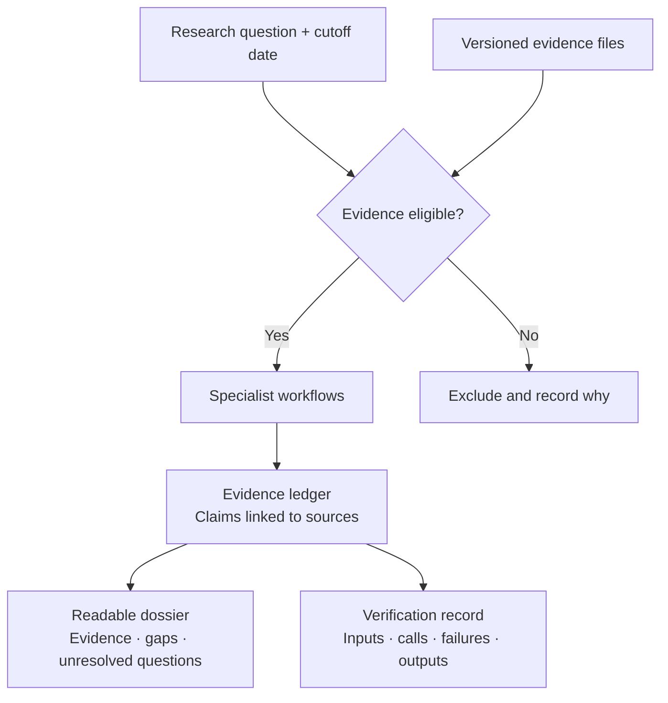

# TETHER

### A traceable path from drug-target question to evidence dossier

**Ask a research question. Review eligible evidence. Trace every accepted claim back to its source.**

TETHER is an **agent execution and evaluation harness for drug-target research**—with evidence controls, specialist workflows, and replayable execution records.

*Target Evidence Tracking Harness for Evaluation and Reproducibility*

[Quick start](#quick-start) · [Results](#current-results) · [Documentation](#explore)

## What does it do?

> **Question:** What evidence supports inhibiting **IL6R** in **rheumatoid arthritis** using an **antibody**?
>
> **Output:** An evidence dossier showing accepted claims, source links, missing inputs, and unresolved questions.

You supply the target, disease, intended action, modality, cutoff date, and versioned evidence. TETHER runs the configured workflow and retains a record you can inspect and verify.

<a id="how-it-works"></a>



Specialist routes cover **genetics, perturbation, expression, modality, literature, clinical evidence, safety, and pathways**. Available evidence and backend configuration determine what each route can do.

**Traceable does not mean scientifically correct.** Verification checks provenance and consistency; missing evidence is not biological absence.

<a id="installation-and-compatibility"></a>
<a id="try-it"></a>

## Quick start

**Python 3.11+ · uv · PowerShell** — run from the repository root:

```powershell
uv sync --project packages/tether --python 3.11
New-Item -ItemType Directory -Path runs -Force | Out-Null
uv run --project packages/tether --no-sync tether demo --output runs/my-first-demo
uv run --project packages/tether --no-sync tether verify --run-dir runs/my-first-demo
```

**Offline demo. Fictional evidence. No API key.** Use a fresh output directory each time.

<a id="tether-cli-run-layout"></a>

Open **`runs/my-first-demo/dossier.md`**. The same folder holds the receipt, execution journal, and underlying evidence records. See the [CLI guide](packages/tether/README.md) for real inputs and stronger verification with a separately saved receipt hash.

<a id="what-works-today"></a>

## Current results

Research software; clinical prediction remains unvalidated and real-data probabilities are withheld.

| Completed evaluation | Result |
|---|---|
| [Drug-target pilot](planning/run-registry.json) | 10 development dossiers with a technical source audit |
| [Policy checks](<planning/TETHER Equal Policy Comparison Results 2026-11-05.md>) | TETHER and an independent validator both pass 109/109 constructed cases |
| [Initial SciFact baseline](<planning/TETHER SciFact Native Evaluation Results 2026-11-05.md>) | 27/300 claims strictly correct |
| [Stronger SciFact solver](<planning/TETHER SciFact Full Context Results 2026-11-06.md>) | 127/300 strictly correct; higher F1 but lower rationale recall |
| [Initial LitQA2 baseline](<planning/TETHER LitQA2 Native Evaluation Results 2026-11-06.md>) | 12/199 correct; 178 unsure |

The SciFact gain comes from changing the solver; harness filtering added no correctness gain. Retrieval improvements are [ongoing work](<planning/TETHER Semantic Capability Execution Plan 2026-11-06.md>).

## Explore

| Looking for… | Go to |
|---|---|
| Architecture and verification limits | [Framework](docs/FRAMEWORK.md) · [Verification scope](docs/TETHER-VERIFICATION-SCOPE.md) |
| Data sources and preparation | [Data guide](data/README.md) · [Catalog](data/catalog/sources.json) |
| Code and benchmarks | [CLI package](packages/tether/) · [Experiments](experiments/) |
| Paper and next steps | [Working paper](paper/README.md) · [TODO](TODO.md) |

**Package:** `tether-target-agents`. **Legacy engine:** `src/asof/`, retained for compatibility. **License:** [Apache-2.0](LICENSE); datasets have separate terms. Bulk data and model weights are excluded from Git.
