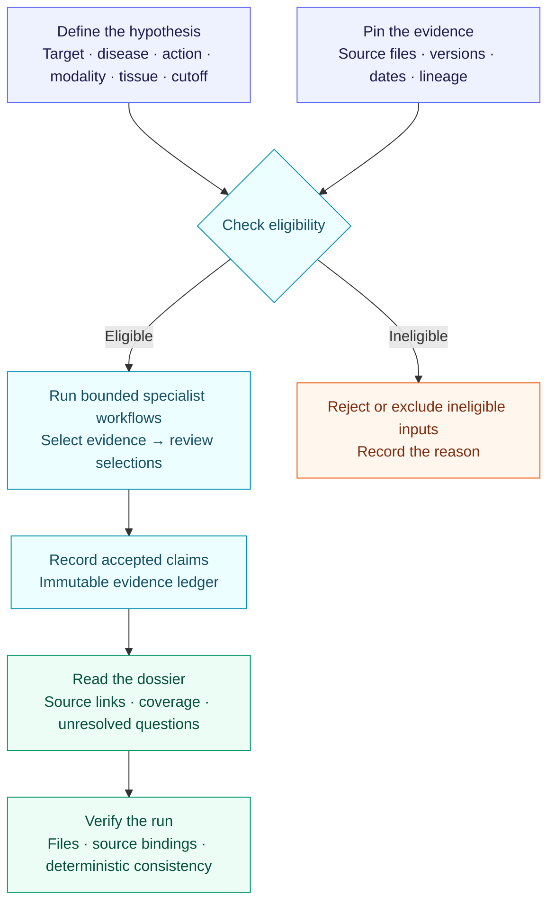

# TETHER

### Traceable evidence for drug-target research

**Give TETHER a target–disease hypothesis and a dated evidence snapshot. Get a source-linked dossier, explicit evidence gaps, and an execution record you can verify.**

TETHER is an **evidence and evaluation harness** with specialist workflows. It checks which evidence a workflow may use, records what it used, and verifies the resulting artifacts.

*Target Evidence Tracking Harness for Evaluation and Reproducibility*

[Try the demo](#try-it) · [How it works](#how-it-works) · [Results](#what-works-today) · [Roadmap](TODO.md)

## What problem does it solve?

A drug-target assessment needs more than an answer. It needs a record of:

- **Where each claim came from** — including its original source and transformations.
- **What was available at the cutoff** — including mappings and annotations.
- **What is missing** — incomplete collection is different from biological absence.
- **What actually happened** — completed calls, failures, budgets and outputs.

For example: organize the evidence for **inhibiting IL6R in rheumatoid arthritis with an antibody**, using only information eligible at a specified date.

## How it works



Execution journals retain progress and failures. Verification checks the declared evidence and computation; **it does not prove biological truth or therapeutic benefit**.

<a id="installation-and-compatibility"></a>

## Try it

Requires **Python 3.11+** and **uv**. From the repository root in PowerShell:

```powershell
uv sync --project packages/tether --python 3.11
New-Item -ItemType Directory -Path runs -Force | Out-Null
uv run --project packages/tether --no-sync tether demo --output runs/my-first-demo
uv run --project packages/tether --no-sync tether verify --run-dir runs/my-first-demo
```

The demo uses **fictional evidence**, runs offline, and needs no API key or biomedical downloads. Use a new output directory each time.

<a id="tether-cli-run-layout"></a>

Open **`runs/my-first-demo/dossier.md`** to read the result:

```text
runs/my-first-demo/
├── dossier.md           # Human-readable assessment
├── tether-receipt.json  # Output integrity record
├── attempt/             # Execution journal
└── engine/              # Evidence ledger, inputs and detailed results
```

To inspect an interrupted attempt without rerunning it:

```powershell
uv run --project packages/tether --no-sync tether inspect-run --run-dir runs/my-first-demo
```

For stronger replacement detection, retain the printed receipt hash separately and supply it to `verify` with `--receipt-sha256`. See the [CLI and policy guide](packages/tether/README.md) for real inputs and the [verification boundaries](docs/TETHER-VERIFICATION-SCOPE.md).

## What works today?

**Research software.** The evidence workflow is implemented; scientific answer quality remains a development target.

| Evaluation | Observed result |
|---|---|
| [Drug-target pilot](planning/run-registry.json) | Ten contemporary development dossiers with a retained technical source audit. |
| [Policy conformance](<planning/TETHER Equal Policy Comparison Results 2026-11-05.md>) | TETHER and an independent validator both pass 109/109 constructed cases. |
| [SciFact](<planning/TETHER SciFact Native Evaluation Results 2026-11-05.md>) | 27/300 public-development claims meet the strict correctness criterion. |
| [LitQA2](<planning/TETHER LitQA2 Native Evaluation Results 2026-11-06.md>) | 12/199 correct; 21 substantive answers and 178 unsure. |

The SciFact and LitQA2 checks preserved the answers but **did not improve their correctness**. Clinical prediction is unvalidated, and real-data dossier probabilities remain withheld.

**Next:** qualify a stronger claim-verification solver, improve literature retrieval, and evaluate citation support, synthesis and ranking. Follow the [execution checklist](TODO.md) or the [detailed plan](<planning/TETHER Semantic Capability Execution Plan 2026-11-06.md>).

## Find your way around

| You want to… | Start here |
|---|---|
| Understand the contracts and workflow | [Framework guide](docs/FRAMEWORK.md) |
| Prepare real evidence | [Data guide](data/README.md) · [Dataset catalog](data/catalog/sources.json) |
| Change the runtime | [TETHER CLI](packages/tether/) · [Compatibility engine](src/asof/) |
| Explore benchmark implementations | [Experiments](experiments/) · [Peer comparison](<reports/TETHER benchmark comparison update 2026-11-06.md>) |
| Read the working paper | [Paper guide](paper/README.md) |
| Inspect decisions and unfinished work | [TODO](TODO.md) · [Planning](planning/) |

The canonical package is **`tether-target-agents` 0.5.2**. The `asof` engine name remains for compatibility with archived runs. Bulk datasets and model weights are excluded from Git. Code is [Apache-2.0 licensed](LICENSE); data permissions are source-specific.
