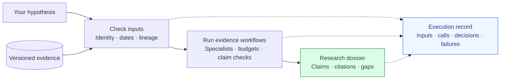

# TETHER

**Trace every drug-target claim back to its evidence.**

TETHER is an **agent execution and evaluation harness** for drug-target research. Give it a hypothesis and versioned evidence; get a dossier of **source-linked claims, evidence gaps, and a verifiable execution record**.

*Target Evidence Tracking Harness for Evaluation and Reproducibility*

[Try it](#quick-start) · [Components](#components) · [Docs](#explore)

<a id="how-it-works"></a>

## How it works

> **Current real-data workflow:** collect source-linked Open Targets annotations for IL6R and rheumatoid arthritis, with coverage and missingness. Historical forecasting remains unqualified and deferred.



| Component | What it does |
|---|---|
| **Evidence** | Tracks source versions, dates, and relationships between inputs. |
| **Execution** | Routes evidence through specialists, limits work, and records accepted claims. |
| **Evaluation** | Checks run consistency and measures scientific answers on benchmarks. |

Specialist routes include genetics, expression, perturbation, pathways, modality, literature, clinical, and safety. Available capabilities depend on the inputs and backend.

<a id="installation-and-compatibility"></a>
<a id="try-it"></a>

## Quick start

**Python 3.11+ · uv · PowerShell** — run from the repository root:

```powershell
uv sync --project packages/tether --python 3.11 --locked
New-Item -ItemType Directory -Path runs -Force | Out-Null
uv run --project packages/tether --no-sync tether demo --output runs/my-first-demo
uv run --project packages/tether --no-sync tether verify --run-dir runs/my-first-demo
```

**Deterministic offline demo · fictional evidence · no API key.** Installation may need network access. Use a fresh output directory each time.

<a id="tether-cli-run-layout"></a>

**Read the result:** `runs/my-first-demo/dossier.md`.

For stronger integrity checking, save the printed receipt hash separately and pass `--receipt-sha256 <saved-hash>` to verification.

[Package and verify an offline run on another machine](docs/PORTABLE-BUNDLE.md).

<a id="what-works-today"></a>
<a id="current-results"></a>

## What works today

| Available | Still unvalidated |
|---|---|
| Offline fictional demo and source-linked execution records | Historical real-data forecasting and clinical probabilities |
| Contemporary Open Targets/HGNC normalization and ten development dossiers | Biological interpretation, therapeutic benefit and causal genetics |
| Retained SciFact/LitQA development measurements | Held-out evidence that the harness improves scientific answers |

The clinical cohort feasibility work produced **no qualified training labels**.
ALCE execution is frozen incomplete; Scholar/R2E comparisons are deferred.
Computed evidence requires a registered, replayable derivation. Fixed-horizon
evaluation accounts for immature and missing cases; clinical-data and scorer
qualification remain unfinished. See the [results and limitations](docs/RESULTS.md).

## Components

- [Engine](src/tether_engine/): evidence admission, specialists, budgets, journals and verification.
- [Public interface](packages/tether/): the `tether` CLI, supervised execution and artifact permissions.
- [Experiments](experiments/README.md): benchmark adapters, native metrics and reconstruction tools.
- [Tests](tests/) and [utilities](tools/): regression checks, source preparation and maintenance.

**A verified run is not a validated scientific conclusion.** Clinical probabilities and therapeutic benefit remain unvalidated.

## Explore

[CLI guide](packages/tether/README.md) · [Architecture](docs/FRAMEWORK.md) · [Results](docs/RESULTS.md) · [Verification limits](docs/TETHER-VERIFICATION-SCOPE.md) · [Data](data/README.md) · [Development](docs/MAINTENANCE.md)

[Apache-2.0](LICENSE). Data has separate terms; bulk datasets and model weights are excluded. The evidence engine lives in `src/tether_engine/`.
