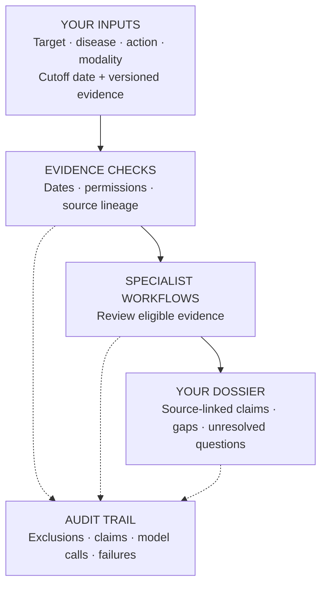

# TETHER

**Drug-target research with a source trail you can inspect.**

TETHER is an **agent execution and evaluation harness**. It connects research questions, versioned evidence, and specialist workflows to produce an auditable evidence dossier.

*Target Evidence Tracking Harness for Evaluation and Reproducibility*

[Try it](#quick-start) · [Results](#current-results) · [Code & docs](#explore)

## From question to evidence

> What evidence supports inhibiting **IL6R** in **rheumatoid arthritis** using an **antibody**, as of a chosen date?

<a id="how-it-works"></a>



| Component | What it does |
|---|---|
| Evidence store | Admits eligible inputs and preserves their provenance. |
| Specialists | Route genetics, perturbation, expression, modality, literature, clinical, safety, and pathway evidence. Capabilities depend on inputs and backend. |
| Ledger & verifier | Link accepted claims to records; check execution integrity and consistency. |

**Traceability ≠ scientific correctness.** Missing evidence is not biological absence; clinical prediction remains unvalidated.

<a id="installation-and-compatibility"></a>
<a id="try-it"></a>

## Quick start

**Python 3.11+ · uv · PowerShell** — run from the repository root:

```powershell
uv sync --project packages/tether --python 3.11
New-Item -ItemType Directory -Path runs -Force | Out-Null
uv run --project packages/tether --no-sync tether demo --output runs/my-first-demo
uv run --project packages/tether --no-sync tether verify --run-dir runs/my-first-demo
```

**Offline demo. Fictional evidence. No API key.** Use a fresh output directory each time.

<a id="tether-cli-run-layout"></a>

Open **`runs/my-first-demo/dossier.md`** for the report. Receipts, the execution journal, and evidence records sit beside it. [Real inputs & stronger verification →](packages/tether/README.md)

<a id="what-works-today"></a>

## Current results

**Built:** 10 development dossiers and technical source audits. **In progress:** retrieval and scientific-answering evaluations. Real-data clinical probabilities remain withheld.

<details>
<summary>Evaluation results and their limits</summary>

| Completed evaluation | Result |
|---|---|
| [Drug-target pilot](planning/run-registry.json) | 10 development dossiers with a technical source audit |
| [Policy checks](<planning/TETHER Equal Policy Comparison Results 2026-11-05.md>) | TETHER and an independent validator both pass 109/109 constructed cases |
| [Initial SciFact baseline](<planning/TETHER SciFact Native Evaluation Results 2026-11-05.md>) | 27/300 claims strictly correct |
| [Stronger SciFact solver](<planning/TETHER SciFact Full Context Results 2026-11-06.md>) | 127/300 strictly correct; higher F1 but lower rationale recall |
| [Initial LitQA2 baseline](<planning/TETHER LitQA2 Native Evaluation Results 2026-11-06.md>) | 12/199 correct; 178 unsure |

The SciFact gain comes from changing the solver; harness filtering added no correctness gain. [Current execution plan →](<planning/TETHER Semantic Capability Execution Plan 2026-11-06.md>)

</details>

## Explore

| Looking for… | Go to |
|---|---|
| Architecture and verification limits | [Framework](docs/FRAMEWORK.md) · [Verification scope](docs/TETHER-VERIFICATION-SCOPE.md) |
| Data sources and preparation | [Data guide](data/README.md) · [Catalog](data/catalog/sources.json) |
| Code and benchmarks | [CLI package](packages/tether/) · [Experiments](experiments/) |
| Paper and next steps | [Working paper](paper/README.md) · [TODO](TODO.md) |

**License:** [Apache-2.0](LICENSE); datasets have separate terms. Bulk data and model weights are excluded from Git. The compatibility engine remains in `src/asof/`.
