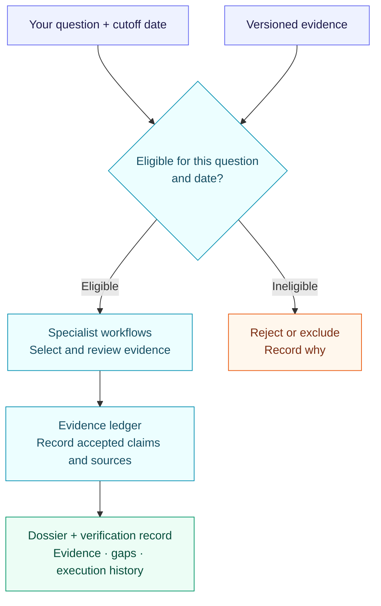

# TETHER

### Drug-target evidence you can trace and check

**Turn a drug-target question and a dated evidence snapshot into a source-linked assessment.**

TETHER is an **agent execution and evaluation harness** for drug-target research. It connects specialist workflows to eligible evidence, records their decisions, and checks the resulting files and claims against their inputs.

*Target Evidence Tracking Harness for Evaluation and Reproducibility*

[Try the demo](#try-it) · [How it works](#how-it-works) · [Results](#what-works-today) · [Roadmap](TODO.md)

## What do I put in—and get out?

For example: **“What evidence supports inhibiting IL6R in rheumatoid arthritis with an antibody?”**

| You supply | TETHER produces |
|---|---|
| Target, disease, action and modality | A readable evidence dossier |
| Tissue, when specified, and a cutoff date | Claims linked to their source records |
| Versioned evidence files | Coverage, missing inputs and unresolved questions |
| Workflow configuration and budget | A verifiable record of calls, failures and outputs |

## How it works



**Verification establishes traceability and deterministic consistency, not biological truth.** Missing data stays explicit; it is not treated as biological absence.

<a id="installation-and-compatibility"></a>

## Try it

Requires **Python 3.11+** and **uv**. From the repository root in PowerShell:

```powershell
uv sync --project packages/tether --python 3.11
New-Item -ItemType Directory -Path runs -Force | Out-Null
uv run --project packages/tether --no-sync tether demo --output runs/my-first-demo
uv run --project packages/tether --no-sync tether verify --run-dir runs/my-first-demo
```

**Offline · fictional evidence · no API key.** Use a fresh output directory each time.

<a id="tether-cli-run-layout"></a>

Open **`runs/my-first-demo/dossier.md`** to read the result:

```text
runs/my-first-demo/
├── dossier.md           # Human-readable assessment
├── tether-receipt.json  # Output integrity record
├── attempt/             # Execution journal
└── engine/              # Evidence ledger, inputs and detailed results
```

For real inputs, interrupted runs and verification with a separately saved receipt hash, see the [CLI guide](packages/tether/README.md) and [verification boundaries](docs/TETHER-VERIFICATION-SCOPE.md).

## What works today?

**Research software:** the evidence workflow works; scientific answer quality remains limited.

| Evaluation | Observed result |
|---|---|
| [Drug-target pilot](planning/run-registry.json) | Ten contemporary development dossiers with a retained technical source audit. |
| [Policy conformance](<planning/TETHER Equal Policy Comparison Results 2026-11-05.md>) | TETHER and an independent validator both pass 109/109 constructed cases. |
| [SciFact](<planning/TETHER SciFact Native Evaluation Results 2026-11-05.md>) | 27/300 public-development claims meet the strict correctness criterion. |
| [LitQA2](<planning/TETHER LitQA2 Native Evaluation Results 2026-11-06.md>) | 12/199 correct; 21 substantive answers and 178 unsure. |

The harness **did not improve answer correctness** in these SciFact and LitQA2 evaluations. Clinical prediction is unvalidated; real-data probabilities remain withheld.

Ongoing work: stronger claim verification, literature retrieval, citation support, synthesis and ranking. See the [execution plan](<planning/TETHER Semantic Capability Execution Plan 2026-11-06.md>).

## Find your way around

| You want to… | Start here |
|---|---|
| Understand the contracts and workflow | [Framework guide](docs/FRAMEWORK.md) |
| Prepare real evidence | [Data guide](data/README.md) · [Dataset catalog](data/catalog/sources.json) |
| Change the runtime | [TETHER CLI](packages/tether/) · [Compatibility engine](src/asof/) |
| Explore benchmark implementations | [Experiments](experiments/) · [Peer comparison](<reports/TETHER benchmark comparison update 2026-11-06.md>) |
| Read the working paper | [Paper guide](paper/README.md) |
| Inspect decisions and unfinished work | [TODO](TODO.md) · [Planning](planning/) |

Package: **`tether-target-agents`**. `asof` is the compatibility engine for archived runs. Bulk data and model weights are excluded from Git. [Apache-2.0](LICENSE) code; source-specific data permissions.
