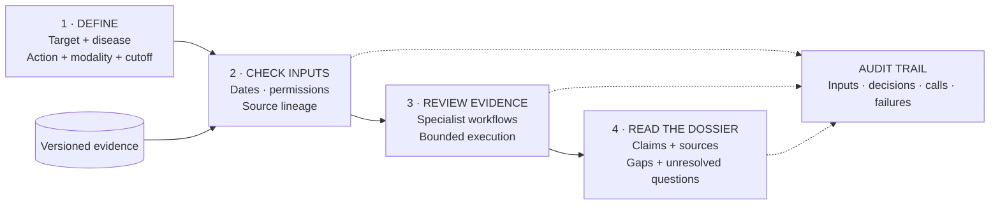

# TETHER

### Drug-target research you can trace back to the evidence.

An **agent execution and evaluation harness** for drug-target research. Turn a hypothesis and versioned evidence into a dossier of **claims, sources, and gaps**.

**T**arget **E**vidence **T**racking **H**arness for **E**valuation and **R**eproducibility

[Run the demo](#quick-start) · [How it works](#how-it-works) · [Results](#current-results) · [Documentation](#explore)

<a id="how-it-works"></a>

## One question → a traceable dossier

> **Example hypothesis:** Inhibit IL6R with an antibody to treat rheumatoid arthritis.



Specialist routes: **genetics · expression · perturbation · pathways · modality · literature · clinical · safety**. Capabilities depend on the data and backend.

**Traceability is not scientific correctness.** Verification checks records and consistency, not clinical benefit.

<a id="installation-and-compatibility"></a>
<a id="try-it"></a>

## Quick start

**Python 3.11+ · uv · PowerShell** — run from the repository root:

```powershell
uv sync --project packages/tether --python 3.11 --locked
New-Item -ItemType Directory -Path runs -Force | Out-Null
uv run --project packages/tether --no-sync tether demo --output runs/my-first-demo
uv run --project packages/tether --no-sync tether verify --run-dir runs/my-first-demo
```

**Fictional evidence · offline demo · no API key.** Installation may need network access. Choose a fresh output directory each time.

<a id="tether-cli-run-layout"></a>

**Read the result:** `runs/my-first-demo/dossier.md`.

Save the printed receipt hash separately; add `--receipt-sha256 <saved-hash>` to verification to check against it. [Real inputs & CLI details →](packages/tether/README.md)

<a id="what-works-today"></a>

## Current results

| Ready | In progress | Not validated |
|---|---|---|
| Offline execution, 10 development dossiers, source audits | Retrieval and scientific-answering evaluations | Clinical probabilities and therapeutic benefit |

<details>
<summary>Benchmark results and limitations</summary>

- [SciFact](<planning/TETHER SciFact Full Context Results 2026-11-06.md>): 27/300 → 127/300 strictly correct after changing the solver; rationale recall fell. Harness filtering added no correctness gain.
- [Initial LitQA2](<planning/TETHER LitQA2 Native Evaluation Results 2026-11-06.md>): 12/199 correct, 178 unsure.
- [Pilot artifacts](planning/run-registry.json) · [Current evaluation plan](<planning/TETHER Semantic Capability Execution Plan 2026-11-06.md>)

</details>

## Explore

| Start here for… | Link |
|---|---|
| Running your own case | [CLI guide](packages/tether/README.md) |
| Architecture | [Framework](docs/FRAMEWORK.md) · [Verification limits](docs/TETHER-VERIFICATION-SCOPE.md) |
| Data | [Data guide](data/README.md) · [Source catalog](data/catalog/sources.json) |
| Research | [Experiments](experiments/) · [Working paper](paper/README.md) |
| Remaining work | [TODO](TODO.md) |

[Apache-2.0](LICENSE). Data has separate terms; bulk datasets and model weights are excluded. The compatibility engine lives in `src/asof/`.
