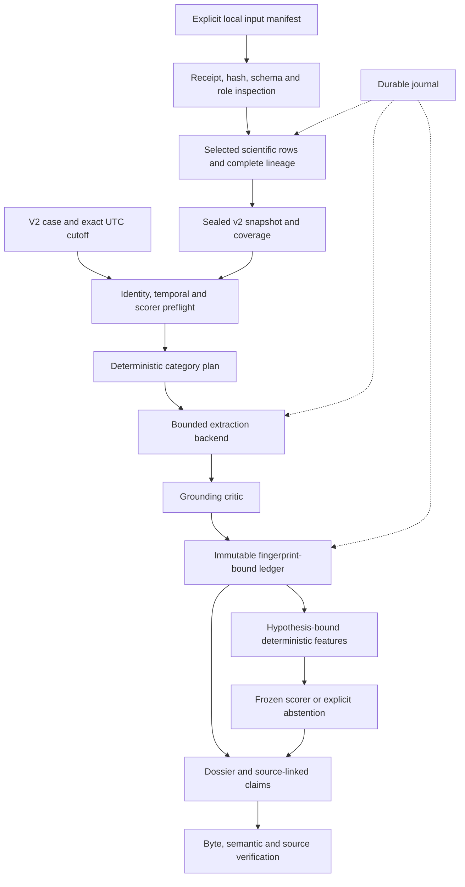

# TETHER — framework: legacy v2 contracts

TETHER (Target Evidence Tracking Harness for Evaluation and Reproducibility) is the current project name. The `tether-target-agents` 0.4.1 package in `packages/tether` supplies the `tether` CLI and import namespace over the frozen AsOf 0.3.11 engine. See [installation and compatibility](../README.md#installation-and-compatibility). Historical version/arm names, module commands, source paths and wire IDs below remain unchanged; the rename does not reactivate retired study or expert-review branches. Direct API aliases preserve legacy outputs; only the separate `tether._presentation` CLI layer wraps `demo`/`run` in the [TETHER run layout](../README.md#tether-cli-run-layout). Delegated source inspection, snapshot construction and evaluation keep their engine layouts.

Version 0.4.1 adds canonical CLI checks for coverage terminal state, reviewed selections versus committed claims and deterministic dossier text. Direct legacy API aliases keep the frozen engine semantics. Archived TETHER 0.4.0 outer runs require the matching old wheel; the new source is not covered by its receipt. See the [critical review](<../planning/TETHER Full Project Critical Review 2026-11-02.md>) for reproduced gaps and limits.

The October 17 build adds opt-in `build-snapshot --packet-layout bounded` for
larger case collections. It partitions whole observations in input order into
individually sealed packets, each including its JSON envelope and newline within
64 MiB. A single oversized observation fails. The default `single` layout still
fails for an oversized case; it never partitions or truncates implicitly.

This uses the existing v2 snapshot artifact list. Observation normalization stays
at recipe 2.2; the build recipe records the layout, limit and code hash. Case
reports include `packets[]` with paths, hashes, byte and observation counts.
`packet_bytes` is their total; `packet_sha256` is null when there are multiple
packets. Consumers must follow the snapshot artifact list or `packets[]`, rather
than assume `evidence.json`. Existing snapshots and receipts are unchanged.
The 256 MiB ledger-output bound and execution budgets remain unchanged, so packet
partitioning alone does not guarantee arbitrary-sized runs can finalize.

TETHER follows the retained [[AsOf Feasibility Analysis and Peer Survey]]: begin with a bounded
extractor and deterministic checks, preserving the useful Virtual Biotech pattern of
planning, specialist routing, review and provenance. Evidence extraction and numerical
prediction remain separate. Scientific validation and Virtual Biotech reproduction
require later work.

[[Framework Code Review and Next Stage Plan]] is the preserved v0.1 review. Its five
correctness findings motivated v2 contracts, nested immutability, preflight temporal
checks, hypothesis-bound features and durable execution. See [[V02_MIGRATION]] for
conversion requirements. Production pilot completion is established by finalized
artifacts and its retained source audit. All ten dossiers and the 20-row technical
source audit are finalized; [[planning/run-registry.json|the registry]] selects the
canonical run explicitly. Scientific adjudication remains outstanding.

## Context revision: normalization recipe 2.2

The reviewed projection now includes `textMiningSentences` (including provider-reported
sections and offsets), `pmcIds`, `studyOverview` and `clinicalSignificances`. Values and
nulls are retained exactly in descriptive `source_metrics` and included in source-row
fingerprints. Conflicting duplicate IDs that differ in these fields fail explicitly.
No article type, citation-chain interpretation, variant direction or efficacy label is
inferred from them. Clinical significance describes a source variant annotation; it is
distinct from the excluded clinical trial status/outcome fields.

The method carries `interpretation_scope: resource_annotation_only`. Snapshot coverage
and dossiers separately state that therapeutic relevance is unassessed. Unspecified
subtype, population, regimen and endpoint remain null. Target-specific qualification
fields identify missing HER2 biomarker status, FH subtype/LDLR function, CFTR
genotype/protein production/modulator mechanism and neuropathy subtype. These are
unresolved design fields, not evaluator answers or refinements of the fixed hypotheses.

Packets use compact canonical JSON with the same 64 MiB limit and complete records.
The build report records the recipe version, projection, source-code fingerprint and
encoding, and binds them into the bundle identity. Old snapshots remain sealed.
`tools/framework/compare_context_revision.py` compares two explicitly selected bundles
and rechecks the original review rows against local originals. Detailed comparison
answers belong in ignored evaluator-only storage. See [[Context Revision Completion]].

## Execution and interfaces



The CLI provides `demo`, `run`, `verify`, `inspect-run`, `inspect-source`,
`build-snapshot` and the separate `evaluate` command. Python 3.11 or later is required.
The default runtime has no third-party dependencies. Ingestion requires the optional
`ingest` extra with exactly `pyarrow==21.0.0`:

```powershell
uv sync --project packages/tether --python 3.11 --extra ingest
uv run --project packages/tether --no-sync tether --help
```

| Subsystem | Responsibility |
| --- | --- |
| Contracts and serialization | Strict v2 decoding, recursively frozen values, canonical fingerprints and bounded JSON |
| Provenance and temporal admission | Catalog roles, source DAG, eligible information dates, receipts and exact packet bytes |
| Agents and ledger | Request-bound selections, grounding, indexed lookup and sealed claims |
| Features and scorer | Hypothesis scope, dependence-aware aggregation, preflight and abstention |
| Workflow and journal | Reservations, bounded dispatch, accounting, durable claims and failures |
| Artifacts and semantics | Archived effective inputs, receipts, source rebinding and recomputation |
| Ingestion | Pinned local products, Arrow filtering, original row locators and coverage |
| Evaluation | Evaluator-only outcome contracts and descriptive metrics |

## V2 case, snapshot and lineage

New execution requires `schema_version: 2` for cases, snapshots and packets. Each case
has a date `origin` and exact timezone-aware `origin_at` whose UTC date agrees with it.
The snapshot must carry the same cutoff. Profiles are `historical_benchmark`,
`contemporary_assessment` and `synthetic_demo`.

A hypothesis identifies target and indication, both namespace versions, intended action,
modality, tissue and mapping availability. Its canonical fingerprint includes all seven
identity/context fields. Numerical observations require matching `feature_scope`;
raw contextual observations may remain visible when their numerical derivation does not
apply. Opposite actions, different modalities/tissues and other programs cannot silently
reuse a case-specific feature.

Program availability is checked for both T1 and T6. T1 additionally requires an active,
origin-eligible Phase 1/2 program, nonzero mapping confidence, and matching next-phase
endpoint with positive horizon. T6 produces an audit dossier and never a clinical
probability. Event outcomes are not case inputs.

Supplied programs in both tasks require nonempty program/molecule identity, sponsor
and status, an integer phase in 0–4, and finite mapping confidence in [0,1]. Explicit
source-supported unknown labels may represent missing sponsor/status; phase 0 is not
an invented substitute for an unknown phase. `eligible_since` is an occurred date and
must be on/before the origin even for T6. Anticipated eligibility needs a future
versioned field; target-only T6 can omit program context. Withdrawn dated programs are
valid T6 context. Confidence zero marks an unresolved mapping: program-specific
observations are excluded (`unresolved_program_mapping`) and cannot enter the ledger.

A snapshot declares packet artifacts, source nodes, a raw-data root and coverage.
Each artifact binds dataset/release, relative path, exact SHA-256, access approval,
catalog role, availability and `input_refs`. Each source node binds its original or
derived input, hash, parents, information availability, role and optional versioned
computation. Real raw sources also bind download receipt paths and hashes. Parents
include all mapping and annotation dependencies. Missing parents and cycles fail.

Catalog policy is archived with the run. Agent evidence and normalization references
retain distinct roles. An `evaluation_only` ancestor is rejected even if its child is
registered as agent evidence. Catalog permission alone does not establish scientific
validity, licensing rights or historical availability.

Normalized JSON inputs are limited to **64 MiB per file**. Generated ledgers have a
separate **256 MiB output limit**, because claim/citation envelopes can expand a valid
packet. Ledger verification and source review use that bounded reader; oversized ledgers
fail before receipt creation. This does not increase evidence admission limits. Packet paths remain under
the snapshot directory; traversal, escaping symlinks, absolute/UNC/drive paths and
alternate data streams are rejected. The loader hashes the bytes it decodes. Raw files
are accessed only through explicit approved-root references.

## Information availability and computation time

Availability retains first-public, release, record and annotation dates, retrieval,
basis and uncertainty. Complete historical date bounds must be known and eligible
at cutoff. Historical profiles accept `verified_historical`, or explicitly approved
`reconstructed` sources; current sources do not fill historical gaps.

A contemporary public-download receipt can establish `known_public_by`, bound to its
receipt hash. Unknown publication/release dates remain null with reasons. This is a
present-day bound, not an original historical release date. Publication dates/years stay
separate and explicitly future-dated information is excluded. Conservative date-only
bounds use the end of that UTC day.

`computed_at` records when a derived result was made. Later computation may use older
eligible information if its complete parents are eligible and its method is versioned.
Later annotations cannot become eligible by appearing inside a computed child.
Admission and semantic verification apply the same eligibility rules.

## Evidence, features and scoring

Observations retain statement/category, observed or missing status, polarity/direction,
study/dependence identity, scientific context, quantitative results, method and declared
QC, limitations, input references, row locator, descriptive metrics and missingness.
Unknown values remain null with reasons. Nested mappings and sequences are copied and
frozen, including parameters, features, coverage and traces.

The eight routes are genetics, perturbation, expression, modality, literature, clinical,
safety and pathway. Retrieval uses exact case identifiers and optional program ID.
Namespace conversion or disease expansion requires an explicit reviewed adapter.

Backends retain `quote(request)` and `select(request)`. Requests expose approved records
and case context without raw paths, labels or download tools. `Selection` contains
observation IDs and `Usage` contains token/cost accounting. Replay entries bind the
selection and exact request fingerprint. The offline extractive backend selects approved
observed records; it is neither a live LLM nor a biological computation.

An explicit `run --local-model config.json` uses a separately owned local
llama-server. It is restricted to an IPv4 loopback endpoint, bypasses environment
proxies, rejects redirects, applies socket inactivity timeouts and makes no provider calls.
That older adapter does not enforce an absolute deadline across a trickling response.
The configuration declares pinned weight/runtime hashes; the trusted launcher must
verify them and own the server. This declaration is not remote model attestation.
The default engine behavior and budget caps are unchanged; the TETHER CLI adds
its separately sealed outer presentation for `demo` and `run`.

`RetrievalPolicy` bounds whole admitted records by count and UTF-8 transport bytes.
The default canonical mode retains the original policy and request fingerprints.
The optional `asof-shared-scientific-fields-v1` mode factors identical fields across
records and references duplicate identity fields in their envelope. It preserves all
fields, nulls, contexts and method parameters and must reconstruct the exact canonical
logical request before dispatch. It uses a finite cache of small immutable parsed
records. It does not summarize, truncate or change scientific observations.
Literal case-token overlap ranks candidates, with stable ID tie-breaking. Provider
scores do not rank or weight evidence. Oversized records are omitted with an explicit
reason; they are not silently truncated. The model selects at most three IDs per
category from a 12-record/12,000-byte default packet. Rendered prompts have a separate
16,384-byte cap, escaped role delimiters and a 256-token generation limit. This is
heuristic evidence selection, not new scientific synthesis or a calibrated predictor.

Retrieval events bind the admitted universe, exact selected/omitted IDs, policy,
request fingerprint and byte count. The critic also checks membership in the actual
bounded request. `backend-execution.json` retains payloads/responses and usage and is
sealed as an auxiliary output. Local-run verification recomputes bounded retrieval
from admitted sources and checks model request, response, selected IDs, measured
usage and dispatch/journal bindings. Local model execution does not establish
therapeutic relevance, independent review or clinical probabilities.
The native response must explicitly report `truncated: false`; valid JSON cannot
qualify a selection from an incomplete or unqualified prompt. The guard also runs
during verification of archived local responses.

The critic rejects duplicate or out-of-packet selections. Accepted claims copy approved
statements and retain registered fingerprints. Backend-authored interpretations do not
enter factual claims. Critic retries are bounded; unexpected provider errors do not
trigger automatic repeat calls.

Features use `asof-features-v2` and `mean_of_unique_dependency_groups_v2`. Their fixed
names cover genetics, direction, perturbation, expression, modality, literature, safety
and pathways. Features require observed evidence, declared passed QC, a versioned
method and matching hypothesis scope. Clinical/known-drug evidence cannot produce them.
Shared study/cohort/group identities connect known dependence; each component contributes
once. Conflicting values within a component are excluded and remaining components are
averaged. Unknown overlap still needs curation. Missing values remain null with reasons
such as unmeasured, failed QC, access denial, inapplicability or incomplete collection.

Scorer schema/profile and training/calibration cutoffs are checked before dispatch.
Malformed configuration fails; a valid but inapplicable scorer abstains. T1 requires
frozen endpoint/horizon, applicability, schema, coefficients, imputation and coverage
rules. Contributions are recomputed from actual features. Incomplete execution abstains.
Synthetic weights are limited to synthetic runs. Real pilot provider scores remain
descriptive; they are not effect sizes or support weights, and numerical prediction
features remain empty.

## Durable execution and verification

The engine details below apply inside `OUT/engine` for a TETHER CLI run, or at
the original output root for legacy API/module commands. TETHER seals the outer
presentation separately; its source-inclusive verification rejects `--outputs-only`.

Defaults are 16 calls, 32,000 input tokens, 8,000 output tokens, $0, 300 seconds and one
critic retry per category. Quoted upper usage is reserved before dispatch. Measured
adapter-reported usage and conservative unmeasured estimates are recorded separately.
Usage above a quote stops execution. Time checks include lengthy claim commits;
partial coverage is retained and incomplete execution abstains.

CLI output directories are reserved exclusively before dispatch. The hash-chained,
fsynced journal retains reservations, attempts, usage, claims and failures. Timeouts,
malformed responses, unexpected errors, interruption and partial writes leave inspectable
records when the filesystem remains writable. Builds retain inspection, stages and
progress. `inspect-run` reads unresolved reservations or build state without restarting
work. New attempts require fresh output directories. Hard termination may leave no
terminal event; the last durable stage is the retained recovery evidence.

Wall-time checks cannot forcibly interrupt an arbitrary blocking backend. The older
local adapter uses socket inactivity timeouts; an absolute total deadline requires
additional supervision. The outer TETHER engine process also lacks a total execution
deadline/output cap; its bounded cleanup starts after an exception. Newer native
transport watchdogs have a separate qualified scope. Source admission/verification time is outside the workflow meter
and is reported separately by the development harness.

Finalization archives effective case/snapshot/scorer, catalog policy, configuration,
replay provenance, code fingerprints and dependency versions. The required v2 receipt
set has eight outputs: run, inputs, ledger, features, prediction, trace, journal and
dossier. `request.json` and `backend-execution.json`, when present, are sealed through
optional `auxiliary_outputs`. Existing valid v1/v2 receipts remain compatible.

| Verification layer | Meaning |
| --- | --- |
| Byte integrity | Receipt hashes and hash chains agree with retained bytes |
| Semantic consistency | Identity, configuration, accounting, journal claims, source fingerprints, deterministic features, scorer contributions and final trace agree |
| Source binding | Complete admitted artifact/ancestor proofs and originals agree; legacy engine `--outputs-only` checks archived fingerprints instead (the TETHER outer verifier rejects it) |
| Scientific validity | Unestablished until independent scientific review |

Source-inclusive verification reapplies admission using archived policy and snapshot.
An independently saved receipt hash detects replacement. Without an anchor, coherent
wholesale substitution cannot be ruled out. Local artifacts are not immutable storage
or trusted timestamps. Code drift is reported separately. V1 retains seven-output byte
verification with `semantic_consistency: unavailable_legacy_v1`.

## Pinned contemporary adapter and pilot

October 18 adds optional `build-snapshot --cases PATH --cases-sha256 SHA256`.
The schema-version-1 authored pack contains `cases[]` with approved `symbol`,
`disease_id`, `intended_action`, `modality` and optional `tissue`, `target_id` and
`hgnc_id`. Explicit identifiers must match the pinned source records; unresolved
cases are blocked without replacements. Duplicate scopes and changed input bytes
fail. The builder archives the exact pack as `case-pack.json` and binds its hash and
scope fingerprint in the journal, recipe and report. Omitting `--cases` preserves
the original ten-case default. The external hash is optional in the general CLI;
a frozen scientific pilot supplies it explicitly.

The new ten-case source-reference pilot is distinct from the canonical earlier
dossiers. Original-row audits and AI source adjudication remain evaluator-only
under `data/benchmark/gold_evidence/science-prerequisites-20261018/`; they must not
enter agent-visible manifests. External contemporary literature can qualify a
source interpretation but cannot silently become historical predictor evidence.

`inspect-source` validates an explicit manifest against receipt identity, bytes, schema,
roles and paths. `build-snapshot` repeats inspection and creates a new snapshot for the
fixed ten T6 hypotheses from Open Targets 25.09 and HGNC 2026-10-10. HGNC remains a
normalization reference. Generated catalog product `asof_normalized_packets` belongs to
provider `project` and retains complete parents.

The adapter maps target/disease `id` and evidence `targetId`/`diseaseId`, checks approved
HGNC symbols and Ensembl IDs, and requires fixed disease IDs. Arrow filtering precedes
Python conversion while preserving original row-group and row offsets. Projection omits
trial outcomes, stop reasons, clinical-status fields, `known_drug` records and the ChEMBL
partition. Unsupported datatypes and rejected rows are counted.

Genetic associations/somatic mutations map to genetics, RNA expression to expression,
animal models to perturbation, affected pathways to pathway and literature to literature.
Reported biosamples, cell models, variant identity/consequence/effect and trait direction
remain source metadata. Cell type is not silently converted to tissue, and variant
direction is not interpreted as therapeutic intervention direction.

Receipt bytes are copied to a content-addressed archive under the approved raw-data root;
lineage uses these copies so transport retries cannot rewrite provenance. Original data
and transport receipts remain untouched. Reports distinguish scanned, selected and
accepted rows, packet bytes, elapsed time, peak memory, selected-subset coverage, missing
files and unknown context. Incomplete collection never establishes biological absence.

The pilot covers CD276/NSCLC ADC; OSMR/ulcerative colitis antibody; ERBB2/breast carcinoma
antibody and ADC; PCSK9/familial hypercholesterolemia antibody and siRNA; IL6R/rheumatoid
arthritis antibody; CFTR/cystic fibrosis small molecule; GLP1R/type 2 diabetes peptide;
and SCN9A/neuropathic pain small molecule. Tissue is unspecified and actions/identifiers
follow the approved fixed pack. Completion requires ten verified dossiers and a retained
review of at least twenty distinct original rows. This review checks normalization
fidelity; biological adjudication remains separate.

## Evaluator boundary and later milestones

Operational metadata corrections use the existing `asof.maintenance update-catalog`
entry point with a `status_correction` public proposal. It checks referenced evidence
hashes, the expected prior catalog hash and the exclusive writer lock. The proposal
can update only collection status, verification and blocker descriptions; it cannot
promote collection to complete, parsing/scientific validation, access/roles or temporal
policy. Dated acquisition snapshots remain intact. Existing catalog formatting is
preserved by its canonical writer. The October 17 correction is separately recorded
from the frozen evaluator-only v0.4 sizing protocol; no clinical labels are added.

`evaluate` imports labels only in its separate command. Labels require matching case,
origin, endpoint/horizon, resolved/censored/unresolved state, event/follow-up/availability
dates, cluster and label freeze. Censored or unresolved cases are not negatives.
The evaluator reports descriptive coverage, AUROC, average precision and Brier scores;
it does not certify an anchored, locked prospective cohort.

Qualified historical cohorts, MR/colocalization, scorer training/calibration, paid
provider adapters, competitor execution, T2–T5 and H6 remain later work. The frozen
registry power study is conditional simulation, not observed comparative performance.
Arbitrary agents require OS-level read-only mounts, evaluator/credential isolation,
controlled network access and contamination audits before locked evaluation. Python
protocols provide no OS containment. Original plans and dated reviews remain preserved;
the download worker and stopped periodic monitor are independent of this milestone.


## Development selection diagnostics

`tools/framework/compare_development.py` compares completed, sealed local T6
requests against a lexical top-three selector and a within-datasource provider-score
top-three selector. It also reports an uncapped extractive candidate reference and
explicit post-selection evidence masks. No clinical labels or evaluator answers
are read. The recorded model responses and usage are reused, with zero new
inference calls. Scores remain descriptive; mixed or missing source scales abstain.

```powershell
uv run --no-sync python -m tools.framework.compare_development --protocol planning/protocols/development-comparison-v0.1.json --output data/derived/comparison-new
uv run --no-sync python -m tools.framework.compare_development --output data/derived/comparison-new --verify-seal-sha256 <saved-seal-hash>
```

The output directory must be new. Status and completed case records survive later
failure. Successful reports archive the executed tool source and a hash manifest.
Verification reconstructs paired selections and deterministic masks from anchored
parent runs; it rechecks archived source proofs without rehashing original raw data.
Selection agreement is not quality, and these masks are not end-to-end model
ablations. Keep transport versions separate. See the October 18 Task 6 report for
exact scope and the pinned Virtual Biotech compatibility audit.
