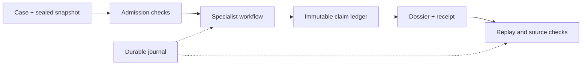

# TETHER architecture

TETHER separates evidence admission, bounded execution and verification. The
public package is `tether-target-agents` 0.6.0 (`tether`); its engine is
`tether-target-engine` 0.4.0 (`tether_engine`). Start with the
[offline demo](../README.md#quick-start) or the [CLI guide](../packages/tether/README.md).

## Core components

| Component | Responsibility | Implementation |
|---|---|---|
| Contracts | Typed cases, evidence, claims and immutable nested values | [contracts.py](../src/tether_engine/contracts.py), [serde.py](../src/tether_engine/serde.py) |
| Admission | Identifier, cutoff, publication, role and complete-lineage checks | [chrono.py](../src/tether_engine/chrono.py), [provenance.py](../src/tether_engine/provenance.py) |
| Execution | Category routing, grounding review, budgets and terminal coverage | [workflow.py](../src/tether_engine/workflow.py), [agents.py](../src/tether_engine/agents.py) |
| Claims | Fingerprint-bound admission and immutable ledger commits | [ledger.py](../src/tether_engine/ledger.py) |
| Features and scoring | Hypothesis-bound derivations, configured contributions and explicit abstention | [features.py](../src/tether_engine/features.py), [scorer.py](../src/tether_engine/scorer.py) |
| Persistence | Reserved output directories, attempts, usage and failures | [journal.py](../src/tether_engine/journal.py), [atomic.py](../src/tether_engine/atomic.py) |
| Verification | Source, claim, feature, trace, accounting and replay consistency | [artifacts.py](../src/tether_engine/artifacts.py), [semantics.py](../src/tether_engine/semantics.py) |
| Public interface | Process supervision, outer receipts and explicit artifact policy | [tether package](../packages/tether/src/tether/) |

`study/` contains separate experimental execution and interpretation interfaces.
[Experiment adapters](../experiments/README.md) implement benchmark-specific
contracts, metrics and isolated workers. Their inputs and evaluation references
remain separate from the agent-visible evidence path.

## Inputs and outputs

A case supplies target and indication identifiers, namespace versions, intended
action, modality, tissue, task and an exact cutoff. A snapshot binds evidence
packets and source lineage. New execution requires version-two contracts.
See the shipped [case](../src/tether_engine/demo/v2/case.json) and
[snapshot](../src/tether_engine/demo/v2/snapshot.json) for fictional examples.

Input references preserve information availability separately from computation
time. A new computation can use eligible older information, but later annotations,
missing lineage and evaluator-only ancestors cannot become eligible inputs.
Program availability is checked before dispatch. Numerical features also require
a derivation scope matching the case's action, modality and context.

The default backend performs deterministic extraction. Replay responses bind to
request fingerprints. A local model is opt-in and requires an explicit configuration;
it is never part of the default demo. The backend interface exposes `quote()` and
`select()` so budget reservation and accepted selection can be checked separately.

The workflow defaults are 16 calls, $0 provider spending, 32,000 input tokens,
8,000 output tokens, 300 seconds and one review retry. These are execution limits,
not estimates of dataset feasibility. Timeouts, malformed responses and interrupted
attempts retain journals; unresolved calls are not automatically repeated.

Completed runs contain source-linked claims, coverage, a readable dossier,
accounting and receipts. Unsupported or missing inputs stay explicit. Incomplete
collection cannot establish biological absence. Numerical predictions require a
compatible scorer; an inapplicable scorer produces abstention.

## Optional local ingestion

The `ingest` extra pins PyArrow 21.0.0. `inspect-source` validates an explicit
manifest, receipts, paths, hashes and schemas. `build-snapshot` reads selected
columns from approved local Open Targets and HGNC inputs, preserving row locators,
lineage and coverage. It reserves a fresh output directory and journals build stages.

Each sealed packet is limited to 64 MiB. The default `single` layout fails for an
oversized case; `--packet-layout bounded` explicitly permits multiple complete
packets. A single oversized observation fails. Raw originals stay unchanged.
See the [data layout](../data/README.md) and [artifact policy](TETHER-CATALOG-POLICY.md).

## Trust boundary

Verification establishes declared consistency, not source authenticity,
biological truth or clinical validity. External receipt anchors help detect whole
output-tree replacement. The framework is trusted local code, not an operating
system sandbox. See [verification limits](TETHER-VERIFICATION-SCOPE.md) and
[development checks](MAINTENANCE.md).
