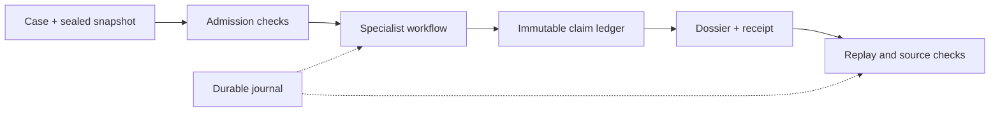

# TETHER architecture

TETHER separates evidence admission, bounded execution and verification. The
public package is `tether-target-agents` 0.7.0 (`tether`); its engine is
`tether-target-engine` 0.5.0 (`tether_engine`). Start with the
[offline demo](../README.md#quick-start) or the [CLI guide](../packages/tether/README.md).

## Core components

| Component | Responsibility | Implementation |
|---|---|---|
| Contracts | Typed cases, evidence, claims and immutable nested values | [contracts.py](../src/tether_engine/contracts.py), [serde.py](../src/tether_engine/serde.py) |
| Admission | Identifier, cutoff, publication, role and complete-lineage checks | [chrono.py](../src/tether_engine/chrono.py), [provenance.py](../src/tether_engine/provenance.py) |
| Computed evidence | Registered deterministic projection and complete-output rederivation | [derivations.py](../src/tether_engine/derivations.py) |
| Execution | Category routing, grounding review, budgets and terminal coverage | [workflow.py](../src/tether_engine/workflow.py), [agents.py](../src/tether_engine/agents.py) |
| Claims | Fingerprint-bound admission and immutable ledger commits | [ledger.py](../src/tether_engine/ledger.py) |
| Features and scoring | Hypothesis-bound derivations, configured contributions and explicit abstention | [features.py](../src/tether_engine/features.py), [scorer.py](../src/tether_engine/scorer.py) |
| Persistence | Reserved output directories, attempts, usage and failures | [journal.py](../src/tether_engine/journal.py), [atomic.py](../src/tether_engine/atomic.py) |
| Verification | Source, claim, feature, trace, accounting and replay consistency | [artifacts.py](../src/tether_engine/artifacts.py), [semantics.py](../src/tether_engine/semantics.py) |
| Evaluation | Common fixed-horizon population, missingness and producer-bound predictions | [evaluation.py](../src/tether_engine/evaluation.py), [evaluation_binding.py](../src/tether_engine/evaluation_binding.py) |
| Public interface | Process supervision, outer receipts and explicit artifact policy | [tether package](../packages/tether/src/tether/) |

`study/` contains separate experimental execution and interpretation interfaces.
[Experiment adapters](../experiments/README.md) implement benchmark-specific
contracts, metrics and isolated workers. Their inputs and evaluation references
remain separate from the agent-visible evidence path.

## Supported and study-specific paths

| Layer | Dependencies and present scope |
|---|---|
| Offline runtime and public CLI | Python plus the two TETHER distributions; fictional fixtures are bundled. Ordinary verification binds producer code and external source paths. |
| Contemporary ingestion | Optional PyArrow 21.0.0, explicit local download receipts and pinned OT 25.09/HGNC inputs; bulk inputs are not bundled. |
| Feasibility utilities | Registry restores, source manifests and optional scientific dependencies; study-specific contracts, not qualified clinical labels. |
| Native model studies | Additional model weights, exact environments, protocols and source archives; many execution paths require Windows file locks. |
| Frozen study reproduction | Matching original code, protocol and retained outputs; a clone alone cannot reproduce the reported private runs. |

The public interface currently imports file/proof helpers from `study/`; the
package separation is not a clean architectural boundary. Simplification and
portable offline bundles support bounded source-inclusive replay after relocation. See [the bundle guide](PORTABLE-BUNDLE.md) and [results](RESULTS.md) for completed
development measurements, failed conditions and the frozen benchmark branches.

## Inputs and outputs

A case supplies target and indication identifiers, namespace versions, intended
action, modality, tissue, task and an exact cutoff. A snapshot binds evidence
packets and source lineage. New execution requires version-two contracts.
See the shipped [case](../src/tether_engine/demo/v2/case.json) and
[snapshot](../src/tether_engine/demo/v2/snapshot.json) for fictional examples.

Input references distinguish information availability from computation time.
Computed observations and source nodes require a registered derivation. The
runtime rederives their information from exact eligible parent bytes, including
text, context, identifiers, quantities and feature scope. Unsupported computed
content is rejected before backend preparation, even when its features are empty.
New deterministic computation on eligible old information is allowed; a later
execution timestamp does not backdate new information.
Missing lineage and declared evaluator-only ancestors are rejected.
Program availability is checked before dispatch. Numerical features also require
a derivation scope matching the case's action, modality and context.

### Registered computation

New runs seal admission policy `tether.derivation.v1`. The initial registry has
one method, `tether.json_projection` version `1`: select a complete JSON value
from a hashed input using an RFC 6901 pointer. Parameters contain only `input`
and `pointer`; replacement text, supplied code and arbitrary expressions are
unsupported. This is a narrow projection primitive, not a scientific feature
derivation library.

The immutable descriptor binds method/version, implementation and parameter
digests, input/asset hashes, output schema and method timing mode. The whole
observation is compared with its projected source, except the computation and
lineage envelope. Before replacing that envelope, the source observation must
pass its original type restrictions and reference only qualified ancestors;
embedded computed observations cannot acquire trust through projection.
Parent computations are recursively checked. Each JSON input
is capped at 64 MiB; aggregate cached derivation bytes are capped at 256 MiB per
validation pass. Ordinary large raw-source checks remain streaming.

`contemporary_method_retrospective` permits a present-day method over eligible
older information. `historical_method_simulation` additionally checks its
registered method date. That date records local implementation registration,
**not authenticated public release**. Neither mode proves provider metadata or
hidden model knowledge. The registered implementation currently supports no
learned-model or causal-genetics computation.

Execution freshly re-admits the store before backend hooks; finalization and
source-inclusive verification check current source bytes again. Ledger checks
reuse a bounded validation pass. See the [migration guide](../packages/tether/MIGRATION.md)
for legacy guarantees and the [test fixture builder](../tests/derivation_fixtures.py)
for a complete fictional projection example that preserves the old demo files.

The default backend performs deterministic extraction. Replay responses bind to
request fingerprints. A local model is opt-in and requires an explicit configuration;
it is never part of the default demo. The backend interface exposes `quote()` and
`select()` so budget reservation and accepted selection can be checked separately.

The workflow defaults are 16 calls, $0 provider spending, 32,000 input tokens,
8,000 output tokens, 300 seconds and one review retry. These are execution limits,
not estimates of dataset feasibility. Timeouts, malformed responses and interrupted
attempts retain journals; unresolved calls are not automatically repeated.

Completed runs contain source-linked claims, coverage, a readable dossier,
accounting and receipts. Unsupported or missing inputs stay explicit. Incomplete
collection cannot establish biological absence. Numerical predictions require a
compatible scorer; an inapplicable scorer produces abstention.

## Optional local ingestion

The `ingest` extra pins PyArrow 21.0.0. `inspect-source` validates an explicit
manifest, receipts, paths, hashes and schemas. `build-snapshot` reads selected
columns from approved local Open Targets and HGNC inputs, preserving row locators,
lineage and coverage. It reserves a fresh output directory and journals build stages.

The existing recipe is contemporary T6 source reporting for OT 25.09 and its
pinned HGNC reference. It does not reconstruct historical releases or derive
validated clinical features; its real-data probabilities remain null.

Each sealed packet is limited to 64 MiB. The default `single` layout fails for an
oversized case; `--packet-layout bounded` explicitly permits multiple complete
packets. A single oversized observation fails. Raw originals stay unchanged.
See the [data layout](../data/README.md) and [artifact policy](TETHER-CATALOG-POLICY.md).

## Fixed-horizon evaluation

The evaluator is separate from evidence admission and agent execution. It does
not create clinical labels or a validated scorer. Current clinical feasibility
limits still apply.

**Eligibility is independent of the observed outcome:** origin plus horizon plus
the policy's reporting lag must be on or before the common label freeze. An early
positive remains in the record but cannot make an immature origin eligible.
Calendar maturity alone does not certify a negative; complete follow-up and
eligible label availability are still required. Mixed endpoints or horizons are
rejected rather than pooled.

The schema-2 metrics report distinguishes registered, mature, label-resolved,
prediction-available and scored cases, with case IDs and exclusion reasons.
Primary Brier/AUROC/AP are withheld when the mature population has unresolved
labels or missing predictions. Available-case diagnostics are explicitly
conditional and must not be used to compare arms with different selected
subsets. The population fingerprint excludes outcome values and prediction
success. It does not establish that registration preceded label inspection.

A missingness sensitivity report bounds possible mean Brier loss over the common
mature population: known outcomes and predictions contribute their observed
loss; unknown outcomes with probability `p` contribute a range between `p²` and
`(1-p)²`; missing predictions contribute `[0, 1]`. These are mathematical
completion bounds, not imputed outcomes, confidence intervals or a censoring
model. Cluster IDs are retained; clustered inference remains unimplemented here.

### Production input contracts

All manifests use strict JSON; unknown fields, duplicate identities, conflicting
dates and invalid numeric types are rejected. Three expected file hashes anchor
the cohort, producer and outcomes. Those hashes establish byte identity, not
independent provenance or a trusted preregistration timestamp.

| Input | Required content |
|---|---|
| Cohort | Schema 1, kind `fixed_horizon_binary_cohort`, `cohort_id`, `label_freeze`, explicit `policy` and every registered member. |
| Policy | Schema 1, one `endpoint`, positive `horizon_months`, nonnegative integer `reporting_lag_days`. |
| Member | `case_id`, canonical full `case_fingerprint`, `origin`, `endpoint`, `horizon_months`, `cluster_id`. |
| TETHER producer | Schema 1, kind `tether_run_predictions`, `arm_id`, exact `cohort_sha256` and one record per member. |
| Sealed-run record | `case_id`, state `sealed_run`, `run_dir`, UUID `run_id`, exact `receipt_sha256` and `prediction_sha256`. |
| Missing record | `case_id`, state `declared_missing`, and a reason; no fabricated probability or verified-execution claim. |
| Outcomes | Existing schema-1 `Outcomes` contract; exact same membership, endpoint, horizon, origins, dependence clusters and common freeze. |

The bound evaluator verifies each sealed run with its original sources, requires
current admission/derivation checks, and matches its full case, reservation UUID
and captured prediction bytes. Direct API archives without a run reservation
remain available to raw diagnostics but cannot qualify this production route.
Finalized failures and abstentions stay in the cohort. Final rereads detect changes
to captured evaluation inputs and run artifacts. Original sources are checked
during each source-inclusive run verification; they are not locked or rehashed
as one cross-run transaction. Reports state these separate checking scopes.
Results are published atomically to a fresh path.

External baseline manifests use kind `external_baseline_predictions`, exact
prediction-file hashes and explicit method/version, code/configuration/model
references and chronology declarations. Code, configuration and model each need
a reference declaration; unknown or inapplicable references require an explicit
reason. Reference declarations are retained but their referenced files are not
automatically opened or authenticated. Their guarantee is **binding to a
producer declaration**, not verified TETHER execution or independently
authenticated provenance. Unsupported provenance stays unknown. Neither route
proves that predictions were produced before the author could access outcomes.

`evaluate` selects the TETHER producer route, `evaluate-baseline` the external
route, and `evaluate-raw` the unverified numerical diagnostic. The bound report
keeps its provenance envelope separate from the metrics function's narrower
scope. The raw API can infer a single endpoint/horizon with zero reporting lag
for compatibility; it declares that inferred policy. Production requires the
explicit cohort policy. All routes require opt-in for synthetic predictions.

See the [CLI guide](../packages/tether/README.md#fixed-horizon-evaluation) and
[migration notes](../packages/tether/MIGRATION.md#evaluation-migration).

## Trust boundary

Verification establishes declared consistency, not source authenticity,
biological truth or clinical validity. External receipt anchors help detect whole
output-tree replacement. The framework is trusted local code, not an operating
system sandbox. See [verification limits](TETHER-VERIFICATION-SCOPE.md) and
[development checks](MAINTENANCE.md).
