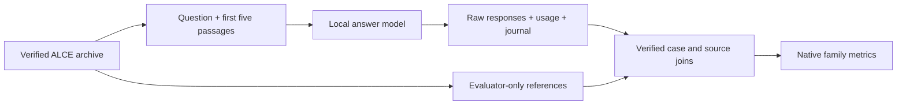

# ALCE evaluation components

Generate cited answers from five supplied passages, then measure their correctness
and citation support with pinned [ALCE](https://github.com/princeton-nlp/ALCE)
scoring code. These components keep source access, execution records and scoring
inputs separate.

## Components

| Module | Purpose |
|---|---|
| `data_views.py` | Check archive receipts; preserve full original records and produce minimal generation inputs. |
| `prompts.py` | Build deterministic family prompts and retain raw output beside citation-syntax diagnostics. |
| `producer.py` | Make one local generation attempt; verify its original response, token counts and settings. |
| `generation.py` | Run the complete frozen schedule with one owned local server and explicit completed, failed and unexecuted cases. |
| `evaluation.py` | Reconstruct case/source/output joins and select full-family lexical, QA, MAUVE or TRUE metric groups. |
| `evaluation_worker.py` | Own one metric group's process, offline runtime, resource limits and retained results; verify its execution records. |
| `native_metrics.py` | Execute exact pinned scoring functions with explicitly supplied dependencies. |
| `native_runtime.py` | Load the pinned TRUE, RoBERTa QA and GPT2-large evaluator assets offline. |
| `native_worker.py` | Supervise flat native qualification jobs and individual QA/MAUVE/TRUE operations. |
| `derived_converter.py` | Explicitly repack verified FP32 TRUE weights into smaller stock PyTorch files, without inference or dtype conversion. |
| `derived_checkpoint.py` | Independently audit tensor layout, aliases and raw bits; validate the cache and its original acquisition lineage. |
| `offline.py` | Deny undeclared Python network activity during evaluator work. |

Asset acquisition is a separate [receipt-producing transport](../alce_transport/README.md).
The default TETHER runtime does not install the model dependencies.

## Execution rules

- Freeze the data, model, prompts, limits and qualification receipts before a run.
  Every output directory must be new. Failed or interrupted calls are retained
  and never automatically repeated.
- The answer model receives questions and offered passage text. Reference answers,
  QA pairs, reference claims and answer-containing markers stay evaluator-only.
- Citation scoring receives the **same five passages** offered to the model.
  Other passages in the archived retrieval pool cannot rescue an invalid citation.
- Keep the original response. ALCE's first-line and citation-removal preprocessing
  runs once for each applicable metric input; no answer repair is hidden in scoring.
- Run lexical, QA, MAUVE and TRUE work in separate bounded process lifetimes.
  TRUE stays resident within its citation/claim group because later NLI calls
  depend on earlier verdicts. MAUVE operates on a complete family distribution;
  averaging scores from smaller batches is invalid.
- Complete source joins are required before scoring. A failed generation has no
  fabricated answer. Partial work retains its full scheduled denominator.

Generation plans and actor jobs use the v2 source-origin contract. They bind stable
repository-relative source identities, exact observed package files and the engine
and facade package origins. Installed packages must have the same complete Python
source tree and bytes as the checkout. The isolated worker loads the parent-admitted
origins; it never silently substitutes checkout packages for installed packages.
This verifies trusted package execution, not hostile Python import attestation.
Legacy v1 plans must be rebuilt and separately released under qualified v2 code;
existing plans, helper qualifications and failed outputs are not rewritten or
retroactively promoted. Model prompts, case ordering and scientific limits are
unchanged by this source-admission migration.

`evaluation.assemble()` requires an externally anchored join plan.
`metric_plan()` lists required family operations; `evaluate_group()` performs one
group with caller-supplied qualified runtimes. These in-process APIs do not provide
process ownership or certify the caller's model. `evaluation_worker.py --help`
describes the full-family group supervisor, including resident branching citation
work. `native_worker.py --help` describes the flat qualification-job supervisor.
Schedule jobs sequentially; neither supervisor provides a cross-job GPU lock.
Metric worker jobs retain schema version 2 and kind `alce_evaluation_worker_job_v2`
for original acquired checkpoints. Version 3 (`alce_evaluation_worker_job_v3`)
adds a required `derived_checkpoint` receipt proof or explicit `null`.
Their `package_context` comes from `evaluation_worker.package_context(deadline)`:
it binds complete package membership, logical source bytes and the parent's
actual package origins. The isolated evaluator imports those exact admitted
origins before opening its job, preserving strict generation-capture source
equality in both installed and checkout environments. Execution and independent
replay reject unknown or extended job schemas. Rebuild and release old jobs with
the new source contract; do not rewrite prior jobs or completed records. The
flat `native_worker` retains v1 for original checkpoints; v2 adds the same explicit
`derived_checkpoint` field. A non-null cache is permitted only for TRUE.
Each evaluator job must declare positive integral `limits.finalization_seconds`
separately from `limits.seconds`; neither has a production default. The latter
bounds the worker, with 30 seconds for process startup and exit. Final verification
has its declared reserve after child return, and all preflight, process and
verification time counts against the combined limit. Size that reserve from the
full retained evidence inventory before dispatch. Native progress logs are retained
in full; the final nonempty UTF-8 stdout line must be the exact terminal receipt.

The optional TRUE cache preserves FP32 storage bits, original key order, alias
groups and model metadata. It changes file boundaries; the native model still
uses the original `.bin` loading and BF16 casting path. Construction reads one
SHA256-verified original into an owned temporary spool, writes bounded shards,
and independently compares each tensor layout and raw storage. Only an audited
spool is removed; failed partial outputs remain. Cache admission rehashes every
derived file and retains complete original-parent proofs. Receipt replay checks
the current metadata and model provenance; it does not claim to reread original
weight bytes. An externally anchored successful derivation and fresh native
behavior qualification are required before using this cache for scoring.

The current native execution path targets Windows with CUDA. Portable tests use
invented dependencies and do not establish Linux GPU execution. Pin and qualify
the complete model environment separately before scoring actual answers.

## Interpreting results

File integrity, runtime qualification and scientific accuracy are distinct checks.
Passing invented controls does not establish benchmark performance or biological
validity. Preserve native undefined values and edge cases alongside explicit
missingness and citation-validity diagnostics. Report the actual data/model
conditions; a different answer model does not reproduce the authors' published
scores.

Dataset text, model weights, private runs and working notes stay outside the public
repository. Reuse and redistribution terms must be checked for each acquired product.
