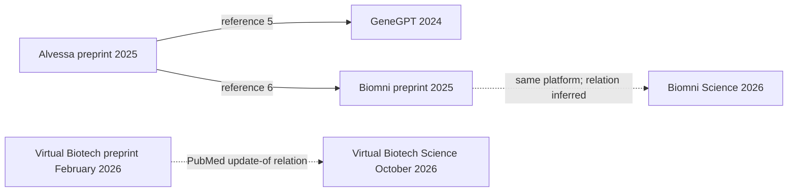

# Primary-source related-work audit

Checked 1 November 2026 UTC. This is a bounded seed-driven check for the technical
paper, not an exhaustive novelty survey or systematic review. It starts from
the existing Virtual Biotech/evaluation seeds and traces a small number of
directly verified backward references. No comparator was executed. No benchmark
dataset or model was acquired. Bibliographic records are in [references.bib](references.bib).

## Canonical versions and supported positioning

| BibTeX key | Primary record and version checked | Supported comparison |
| --- | --- | --- |
| `zhang2026virtualbiotech` | [Science record](https://pubmed.ncbi.nlm.nih.gov/42752167/), DOI 10.1126/science.aeg6779, 22 October 2026 | Organizes agents around therapeutic-development functions. AsOf's current study measures bounded source reporting, not reproduction of its scientific analyses. |
| `virtualbiotech71f9` | [Pinned README](https://raw.githubusercontent.com/harrisongzhang/TheVirtualBiotech/71f9da68c95c5ee0ef4c1d9b8f45f10693de022d/README.md), revision 71f9da68 | Documents headless execution and separate artifact-integrity/evidence-coverage verification. Claims that this baseline is interactive-only or checks hashes alone are incorrect. |
| `sokolova2025alvessa` | [Primary preprint](https://pmc.ncbi.nlm.nih.gov/articles/PMC12773016/), version 1, DOI 10.64898/2025.12.30.697073 | Already verifies generated statements against retrieved records and tests deliberate corruptions. Neither generic verification nor corruption controls establish novelty for AsOf. |
| `le2026txbench` | [arXiv version 2](https://arxiv.org/abs/2606.19245v2), 18 June 2026 | Uses structured answers and deterministic grading for preclinical decisions. AsOf's literal native-field task has a narrower endpoint. |
| `qu2026biomnibench` | [Primary indexed version-2 page](https://www.biorxiv.org/content/10.64898/2026.05.12.724604v2), DOI 10.64898/2026.05.12.724604 | Reports expert-built process rubrics. Those judgments and their validation cannot be inherited by this source-fidelity study. Direct page/full-text fetches returned 403; only indexed primary metadata/abstract are used here. |
| `gao2023alce` | [EMNLP publication](https://aclanthology.org/2023.emnlp-main.398/), DOI 10.18653/v1/2023.emnlp-main.398 | Separates answer correctness and citation quality. Their distinction is established prior work. |
| `saadfalcon2024ares` | [NAACL publication](https://aclanthology.org/2024.naacl-long.20/), DOI 10.18653/v1/2024.naacl-long.20 | Combines learned judging with human annotations for inference. The present descriptive counts do not acquire its human-calibrated guarantees. |
| `windisch2026show` | [Cureus article](https://pmc.ncbi.nlm.nih.gov/articles/PMC13252682/), DOI 10.7759/cureus.108666 | Separately checks quotations and support judgments. A mechanically valid source binding does not settle scientific meaning. |
| `patel2025r2e` | [ACL publication](https://aclanthology.org/2025.acl-long.167/), DOI 10.18653/v1/2025.acl-long.167 | Predicts and explains target rankings against outcomes. No comparable clinical endpoint is evaluated here. Cite the 2025 publication, retaining the 2024 preprint relation. |
| `huang2026biomni` | [Science publication](https://pubmed.ncbi.nlm.nih.gov/42424436/), DOI 10.1126/science.adz4351 | Reports broad biomedical workflow execution under the Biomni name. The related 2025 preprint is separately identified; an indexed publication-update relation was not found. |
| `jin2024genegpt` | [Bioinformatics article](https://pubmed.ncbi.nlm.nih.gov/38341654/), DOI 10.1093/bioinformatics/btae075 | Uses domain APIs for genomic questions. Tool-based access to biomedical databases predates AsOf. |

The two dataset entries identify the archived platform and normalization
reference. They are acquisition pointers, not proof of first-public availability,
rights clearance or a provider-certified annotation version. Release cards must
separately verify access/redistribution terms and preserve original receipt hashes.
The HGNC archive documentation was accessible. The Open Targets FTP directory
could not be opened through the web tool in this pass; that tool limitation does
not negate the independently verified local files or establish present archive
failure. No fresh transfer or historical-availability test was performed.

## Verified lineage

Alvessa's primary reference list explicitly cites GeneGPT as reference 5 and the
2025 Biomni preprint as reference 6. These are citation edges, not inferred
software dependencies. Both Biomni records describe the same named platform;
their publication relation below is an inference from primary abstracts and
overlapping authors, not an indexed update relation. The later title is separate;
the 2025 paper is not described as citing a future 2026 publication.

No forward-citation expansion, citation-count ranking or unobserved citation edge is
claimed. Citation counts remain uncollected. The direct checks used primary
PubMed/PMC records, ACL Anthology, arXiv/bioRxiv and the pinned author repository.
Queries resolved the BiomniBench DOI, canonical ACL R2E article, Biomni journal
record and GeneGPT article. The failed bioRxiv opens are retained as an access
limitation rather than silently converted into a full-text review.

## Claim-safe manuscript framing

Existing work already supplies tool orchestration, retrieved-record verification,
structured scientific benchmarks and citation evaluation. The supportable AsOf
contribution is a bounded implementation and technical feasibility study combining
time/ancestor/scope admission, typed literal facts, evaluator-role separation and
durable source-inclusive replay. It is not established as the first system with
verification, a superior biomedical reasoner or a new clinically validated target
benchmark. The source/reporting endpoint and its incremental contribution must
remain explicit in the abstract, related work and limitations.

Feature absence in other systems is **not assessed** unless directly documented.
No comparison table should translate an unreviewed capability into a negative
mark. The original broad scientific hypotheses and expert-preference endpoint
remain untested; the negative local model controls are separate development
observations. This paper's favorable constructed guard contrasts do not reverse
those limits.
