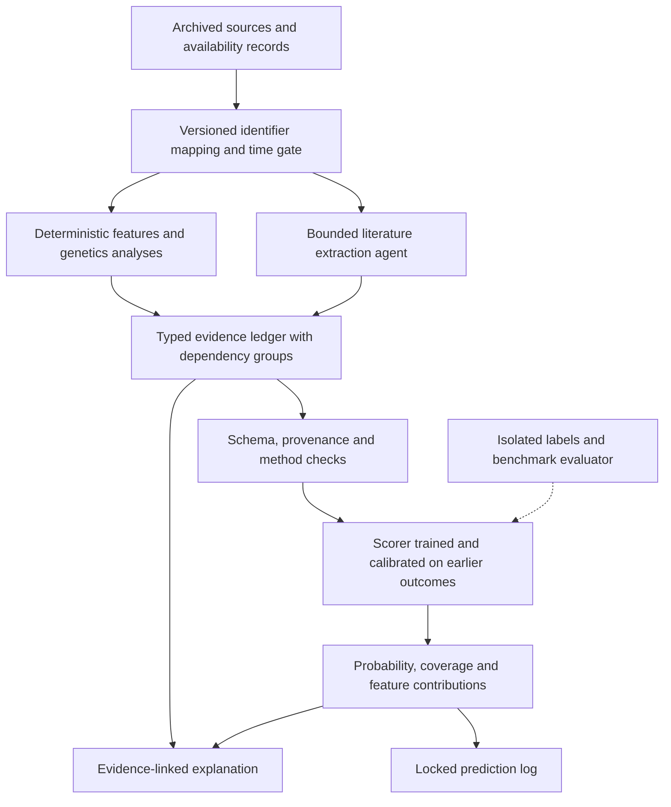
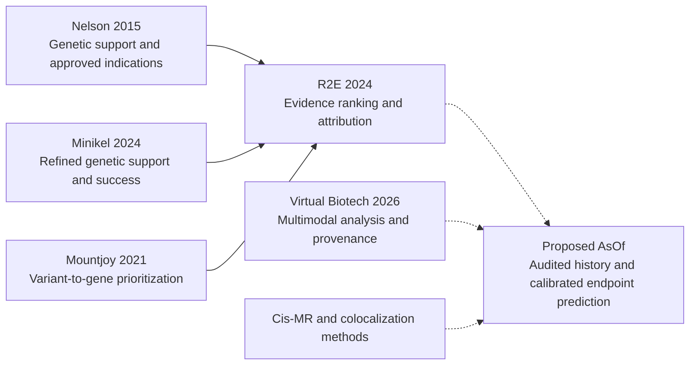

# AsOf feasibility analysis and peer survey

Reviewed October 9, 2026. Inputs: [[Beyond the Virtual Biotech Tooling Gaps and Project Plan]] and [[Agentic Target-Evaluation Frameworks Critical Review]]. The requested emphasis is Virtual Biotech and the related systems in the critical review.

## Decision

**Proceed with a narrower feasibility phase. The proposed framework is buildable, but the full eight-month plan does not yet support its promised claim of better target judgment.** Its most defensible contribution is an auditable evaluation protocol that separates evidence availability, extraction quality, predictive scoring, and scientific interpretation. Superiority over Virtual Biotech remains a hypothesis.

The project has three independent feasibility gates: reconstructing historical evidence, constructing sufficiently mature and trustworthy labels, and isolating the framework's contribution from supervised prediction. Building more specialist agents will not resolve these gates.

| Dimension | Assessment | Reason |
| --- | --- | --- |
| Typed evidence ledger, reproducible tools, transparent scorer | High technical feasibility | Standard data engineering and statistical modeling; no new foundation model is necessary |
| Historical data layer over a few selected sources | Moderate feasibility | Archives exist, but schema changes, annotation history, and availability dates require source-specific work |
| Cross-domain public-data causal genetics | Moderate feasibility | Accessible summary statistics exist; instrument coverage, LD, tissue relevance, and access terms constrain usable cases |
| Retrospective prediction of documented clinical progression | Moderate feasibility after label construction | Trial records are available; trial-to-program-to-target mapping and censoring are difficult |
| A clean claim about biological target validity | Low feasibility from clinical progression alone | Progression also reflects molecule, modality, patient selection, sponsor, and business decisions |
| Demonstrating a 0.05 AUROC gain on approximately 400 cases | Unproven; potentially underpowered | Effective sample size and paired estimator correlation matter more than raw row count |
| All six benchmark tasks, multiple agents, expert panel, H6, and June 2027 preprint | Low feasibility at the stated staffing | Several substantial research projects are bundled together |
| Apache-2.0 code with a redistributable benchmark | Feasible with separate source-specific terms | A single code license does not license external data or restricted competitor components |

These are review judgments, not measured probabilities of success. Assume the proposed 1–2 full-time engineers, part-time statistical genetics expertise, and public data; institutional licenses and compute credits have not been established.

## Most consequential corrections to the plan

| Planning assumption | Finding | Required revision |
| --- | --- | --- |
| The model's reliable knowledge date bounds training contamination | Official documentation distinguishes reliable knowledge from training-data cutoff | Use the latest training cutoff across every prediction-influencing model; describe remaining uncertainty |
| Sonnet 4.5 can remain the fixed comparison model through the project | Current official documentation lists retirement on November 30, 2026 | Resolve model availability before preregistration; distinguish historical reproduction from a model-matched comparison |
| A 24-month post-cutoff outcome test can finish by June 2027 | Both proposed models list July 2025 training-data cutoff | An August 2025 origin reaches its 24-month horizon in August 2027, before allowing reporting lag |
| Masking Open Targets 25.09 reconstructs an earlier world | Later curation, gene assignment, evidence scores, and ontology mappings can survive publication-year filtering | Start from historical releases and record provenance for each transformation |
| 56,707 trial labels are close to benchmark-ready cases | The downloaded CSV has 29,100 decisive endpoint labels and no dated availability fields | Reconstruct dated program outcomes; keep unknown and incompletely observed records explicit |
| AWS Open Data implies anonymous, indexed cis-window retrieval for UKB-PPP | Registry says controlled access; anonymous listing returned HTTP 403 | Test authorized object access and file indexing; budget for per-protein downloads if needed |
| Better predictions demonstrate a better agent framework | AsOf adds a supervised scorer absent from the primary baseline | Compare shared scorers and deterministic extraction as well as complete systems |
| Matched pairs and repeated seeds solve a small sample | They reuse observations and do not create independent outcomes | Simulate power with actual program/target clusters; use repetitions to measure instability |
| A fixed set of specialists is necessary for every case | Some sources will be unavailable or irrelevant to many targets | Start with a bounded workflow and route only when evidence can change a decision |
| All listed non-oncology perturbation examples represent primary-cell biology | K562 is leukemia-derived; RPE1 is an immortalized epithelial model | Audit tissue, cell origin, perturbation type, and disease relevance for every screen |

For the model findings, the official Sonnet page lists January 2025 reliable knowledge, July 2025 training data, and November 30, 2026 retirement. Haiku lists February 2025 reliable knowledge and July 2025 training data. The English Sonnet page could not be fetched; the official Spanish-localized page exposes the specification fields in English. Recheck these mutable lifecycle dates immediately before committing the experiment. [Sonnet specifications](https://platform.claude.com/docs/es/models/sonnet-4-5/overview), [Haiku specifications](https://platform.claude.com/docs/en/models/haiku-4-5/overview).

The perturbation distinction is supported by the original genome-scale Perturb-seq study, which contrasts K562 with non-cancerous, hTERT-immortalized RPE1. Non-cancerous does not mean primary cells or disease-relevant physiology. [Replogle et al., Cell 2022](https://pmc.ncbi.nlm.nih.gov/articles/PMC9380471/).

## 1. Framework feasibility

### 1.1 Define the prediction target before the architecture

The proposed unit, `(target, indication)`, is appropriate for biological evidence aggregation but insufficient for many clinical decisions. The same gene can be inhibited, activated, degraded, or used as an ADC delivery antigen. These mechanisms cannot share a single biological interpretation. Different molecules against the same target can have different exposure, selectivity, safety, and trial results.

Store a biological hypothesis separately from its clinical programs:

- **Hypothesis:** target identifier, indication and ontology version, intended action, modality, relevant tissue, and as-of date.
- **Program:** molecule, sponsor, indication, action/modality, development stage, linked trials, and eligibility dates.
- **Prediction:** endpoint, horizon, probability, feature snapshot, scorer version, and applicability/coverage status.

For the first benchmark, choose one endpoint such as **documented Phase 2-to-Phase 3 progression within a fixed horizon among programs active at the origin**. If drug-level programs are aggregated to target–indication pairs, preregister exactly how: first qualifying program, any program, or a hierarchical model. The “any program succeeds” rule favors targets with many attempts, so include program count and a sensitivity analysis with one program per hypothesis.

Report the number as a probability of the specified observable development event. It is not a probability that the target is biologically causal or that an intervention would benefit a patient. Retain efficacy evidence, safety liabilities, and modality feasibility as separate dossier conclusions.

### 1.2 Preserve the useful separation of evidence, scoring, and explanation

The plan's strongest architectural choice is that specialists record evidence and a separate scorer produces the number. Make the first version simpler:

The evaluator can supply training labels during the training stage; locked test labels remain isolated from feature generation, agents, prompt selection, and calibration. This is a proposed design, not an implemented system.

Use Parquet plus DuckDB for immutable evidence slices and feature computation, and a small relational store for mappings, availability records, and run manifests. A graph database is optional. MCP should expose stable, narrow operations; it is an interface, not the provenance or time-control mechanism. Package statistical genetics in pinned R/Python containers and expose their outputs through tools. Linux or WSL is a practical deployment target for the mixed R/Python stack.

Start with one orchestrator, one bounded extraction specialist, and deterministic checks. Add a genetics specialist and a critical reviewer only after they improve a measured outcome. An eight-specialist architecture increases cost, trace volume, and correlated errors before its benefit is established.

### 1.3 The ledger needs more than evidence type and strength

Recommended fields:

| Field group | Required content | Why it matters |
| --- | --- | --- |
| Identity | Canonical target, indication, molecule where relevant, ontology/build version | Prevents silently merging incompatible hypotheses |
| Temporal provenance | Source release; first-public availability; record/version availability; retrieved date; uncertainty in each date | Distinguishes old studies from newly released or newly curated records |
| Scientific context | Species, ancestry, tissue/cell type, disease state, intervention, exposure proxy, comparator | Prevents context-free causal or safety conclusions |
| Quantitative result | Effect size and scale, standard error/CI, sample size, instrument strength, adjusted significance where appropriate | Makes results comparable and auditable |
| Evidence identity | Study ID, cohort, dataset, source URL, artifact hash, dependent evidence group | Stops duplicate counts from overlapping resources and studies |
| Interpretation | Supports/refutes/uncertain; mechanistic direction; limitations; extraction confidence | Distinguishes biological absence from uncertain interpretation |
| Method provenance | Code/container version, parameters, QC result, failure reason | Enables rerunning a calculation and checking assumptions |
| Feature mapping | Feature names and aggregation rule, scorer version, applicable/unknown status | Allows faithfulness tests against the number actually produced |

Open Targets, Europe PMC, and an MR analysis may all derive from the same underlying GWAS. Three records do not constitute three independent pieces of evidence. Aggregate by study/cohort and distinguish replicated evidence from reused evidence.

Keep **absent**, **not measured**, **failed QC**, **access denied**, and **outside applicability** separate. Otherwise missing data will quietly become a negative biological signal. The scorer must report applicability and coverage alongside probability; abstention is reasonable when the input differs materially from training.

### 1.4 Time control is a data-engineering project

Use two temporal concepts: when the scientific observation occurred and when its relevant version became publicly available. The latter governs benchmark eligibility. For derived annotations, record the availability of the inputs and the annotation method/version. A publication in 2019 does not make a later QTL release or a 2025 disease mapping available in 2019.

Partition sources into:

1. **Verified historical snapshot:** closest release at or before the origin, with its original record and annotation versions.
2. **Reconstructed history:** records recoverable from version histories, with documented assumptions and uncertainty.
3. **Contemporary evidence:** usable for present-day dossiers or prospective predictions, excluded from historical claims.

Historical raw data can be analyzed with the proposed new method; the paper must say that it evaluates a new method on information available at the time. Later scientifically informed curation or models that encode the answer are a different issue and require controls.

Preserving the 25.09 table schema is useful for Virtual Biotech compatibility, but populate it from eligible historical sources. Set unavailable fields to null with explicit coverage metadata. Do not backfill them from the recent dump. A pilot across several old releases must establish that the transformation is tractable before promising rolling origins in 2019, 2021, and 2023.

The pinned `query_evidence` code explicitly permits null `publicationYear` under both minimum and maximum year filters. If the column is missing, that date condition is not applied. This confirms a leakage-control gap, not a finding about the accuracy of the whole system. [Pinned association-tool source](https://github.com/harrisongzhang/TheVirtualBiotech/blob/71f9da68c95c5ee0ef4c1d9b8f45f10693de022d/src/mcp_servers/association_mcp/tools.py#L828).

### 1.5 A time-aware MCP does not contain an agent with unrestricted execution

I verified that the pinned registry grants specialists Bash and several roles web tools; the trial tool points to the live ClinicalTrials.gov API. A masked MCP dataset can therefore be bypassed by a direct network request. [Pinned registry](https://github.com/harrisongzhang/TheVirtualBiotech/blob/71f9da68c95c5ee0ef4c1d9b8f45f10693de022d/src/agents/registry.py), [Pinned trial tools](https://github.com/harrisongzhang/TheVirtualBiotech/blob/71f9da68c95c5ee0ef4c1d9b8f45f10693de022d/src/mcp_servers/clinicaltrials_mcp/tools.py).

Enforce access outside the agent: mount only approved artifacts, remove label files and general credentials, deny external data-network egress, and allow model requests through a controlled endpoint. Route every source request through the archived-data service. Log denied attempts, package downloads, environment configuration, and shared cache keys. Install dependencies before the test.

Canaries test whether retrieval controls catch planted future facts. They cannot prove the absence of pretrained knowledge. A bare-model contamination probe is likewise a diagnostic with false negatives, not a certificate. Report historically constrained retrieval separately from fully prospective prediction.

### 1.6 Causal genetics is feasible if the agent cannot choose its statistical standards

Reimplement a fixed cis-MR workflow rather than adopting MRAgent's defaults. Its inspected template relaxes the instrument threshold from `5e-8` to `5e-6` and then `5e-5` when fewer than 11 variants are returned. A separate branch relaxes below five. These are confirmed code findings. [Pinned MRAgent tool implementation](https://github.com/xuwei1997/MRAgent/blob/0f661b85197306418cf628b7808ff34f79bb87ac/mragent/agent_tool.py#L283).

The initial module should harmonize alleles and genome builds; use a specified cis window; test instrument strength; handle correlated instruments with ancestry-matched LD; and run MR alongside colocalization. Use a Wald ratio for a suitable single instrument and an appropriate multi-instrument estimator when available. Few cis instruments do not justify mechanically importing an 11-instrument minimum or treating MR-Egger as informative.

Handle sample overlap explicitly, especially UKB-PPP against Pan-UKB. FinnGen can provide an independent outcome cohort for appropriate endpoints, but independence and ancestry compatibility must be checked per analysis. Use full regional statistics for colocalization, not just significant hits. Record sensitivity to priors and multi-signal assumptions; coloc-SuSiE is relevant where the data and LD support it. [MR guidance](https://pmc.ncbi.nlm.nih.gov/articles/7384151/), [Multi-signal colocalization](https://doi.org/10.1371/journal.pgen.1009440).

The sign of a plasma-protein association is not automatically an inhibit/activate prescription. Protein-binding artifacts, tissue-specific effects, abundance versus activity, lifelong genetics versus adult dosing, and nonlinearity require triangulation. Use variants with credible functional interpretation, cross-assay support where possible, and known mechanisms as checks. Return “mechanism unresolved” when appropriate. [Drug-target MR principles and assay caveats](https://pmc.ncbi.nlm.nih.gov/articles/PMC7320010/).

Apply multiplicity control over a declared analysis family. A phenome-wide scan generates hypotheses about potential on-target effects; it does not estimate clinical adverse-event incidence. A null scan can reflect low power. Treat safety scans as dossier evidence initially, with limited benchmark claims.

### 1.7 Prove where any improvement comes from

The complete AsOf versus Virtual Biotech comparison is useful for practical performance, but it does not identify a framework effect. AsOf has additional computation and outcome-trained weights. Use a compact factorial comparison:

| Arm | Evidence generation | Scoring | What it identifies |
| --- | --- | --- | --- |
| A | Deterministic archived-data features | Regularized supervised scorer | Strength of data plus ordinary predictive modeling |
| B | Virtual Biotech evidence converted through a fixed adapter | The same scorer and training protocol | Value of its retrieval/analysis relative to deterministic extraction |
| C | AsOf-generated ledger | The same scorer and training protocol | Increment from the proposed extraction/analysis workflow |
| D | Same approved evidence packet for both systems | LLM-stated probabilities | Reasoning/orchestration differences under matched information |
| E | Each complete system under the same historical source policy | Native probability or preregistered adapter | Practical system performance and cost |

Also compare both systems with and without the **same precomputed cis-MR features**. This separates the value of the genetics calculation from the agent's ability to produce it. Equal raw sources alone do not imply equal usable information.

Start with regularized logistic regression and a small feature set. Fit preprocessing, feature selection, and calibration only on earlier training/validation folds. Boosted trees can be a secondary comparator when sample size permits. Refit calibration only using allowed earlier data, and evaluate it on the natural outcome prevalence.

For feature attribution, expose actual scorer contributions and source groups; verify that deleting attributed evidence changes the score. This tests faithfulness to the predictor, not causal correctness of the explanation. The LLM should explain those contributions without inventing additional numerical weights.

### 1.8 Virtual Biotech integration is manageable but should be described honestly

Its current repository documents a headless runner, configurable Claude models, provenance verification, and a core installation around 40 GB with 16 GB RAM recommended. This supports reuse as a baseline; “no batch mode” should be narrowed to the absence of a standardized clinical-outcome evaluation harness at the audited version. [Current setup and headless interface](https://github.com/harrisongzhang/TheVirtualBiotech).

Pin the proposed historical commit and separately record the current commit used for an optional reproduction. A data adapter, an AACT shim, network containment, a revised prediction question, and a numeric-output parser are benchmark adaptations even if the agent's orchestration code is unchanged. Publish those adaptations and distinguish results from the system as originally released.

An ordinal confidence term measures confidence in a dossier conclusion, which may differ from probability of phase advancement. Do not silently map “strong” to a probability. Preregister a numeric-output request and a parsing policy; optionally fit an ordinal adapter on earlier validation data. Report missing outputs, refusals, run failures, and retries as outcomes of the system.

## 2. Data access, validation, and benchmarking

### 2.1 Access categories and what this review actually tested

“Public” can mean anonymous download, account-mediated summary data, browsable results, or material available only under restricted terms. These categories have different operational implications.

I made small unauthenticated requests and inspected six files from Virtual Biotech's pinned commit, including its 6 MB label CSV. I did not create accounts, download the full Open Targets/AACT/pQTL datasets, execute any agent, or run MR. The audit JSON records HTTP results and source hashes. A source documentation page responding is not a validated analysis-ready download.

| Source | Intended use | Access and temporal feasibility | MVP decision |
| --- | --- | --- | --- |
| Open Targets archives | Evidence, target annotations, baseline features | Anonymous archive directory responded HTTP 200. Historical releases are available, but transformed schemas and source-level availability need work. Platform documentation identifies CC0 data and Apache-2.0 code | Core backbone; select 2–3 origins before expanding. [Archive](https://ftp.ebi.ac.uk/pub/databases/opentargets/platform/), [Terms](https://platform-docs.opentargets.org/licence) |
| AACT / ClinicalTrials.gov | Historical trial state and program transition evidence | Official service describes historical snapshots and account access. Indexed monthly lists include 2017–2026. The directly tested legacy flatfile listing returned 404; no archive file was restored | Critical dependency; authenticate and restore actual origin/follow-up snapshots in Phase 0. [Current access](https://aact.ctti-clinicaltrials.org/landing), [Indexed archive listing](https://aact.ctti-clinicaltrials.org/downloads/snapshots?type=flatfiles) |
| ChEMBL dated releases | Molecule/target/MoA mapping, known development state | Anonymous release directory responded HTTP 200. Direct ChEMBL data are CC BY-SA 3.0. Earlier releases may have incomplete target or trial mapping | Core mapping source; preserve original terms and availability. [Releases](https://ftp.ebi.ac.uk/pub/databases/chembl/ChEMBLdb/releases/), [License](https://www.ebi.ac.uk/chembldb/) |
| Virtual Biotech trial labels | Candidate labels and disagreement audit | Downloaded at pinned commit: 56,707 unique NCT IDs. Endpoint, progression, and safety fields need dated reconstruction and program mapping | Bootstrap curation; never equate the release with a clean temporal test set. [Pinned CSV](https://github.com/harrisongzhang/TheVirtualBiotech/blob/71f9da68c95c5ee0ef4c1d9b8f45f10693de022d/datasets/clinical_trials/clinical_trial_labels_reconciled.csv) |
| CTO / CTOD | Secondary trial labels and labeling methodology | Paper describes about 125,000 weakly labeled trials, collected during 2023–2024, and states MIT dataset terms. Linking to targets and dated outcomes is additional work | Supplemental historical labels; not a ready post-2025 outcome set. [Paper](https://arxiv.org/html/2406.10292v3), [Code](https://github.com/chufangao/CTOD) |
| R2E outcome dataset | External comparison task | Released set has noncommercial share-alike terms; its endpoint and commercial-source provenance differ from next-phase progression | Separate academic evaluation only; do not pool it into a permissive release. [Dataset description](https://arxiv.org/html/2402.04068v4#A1) |
| UKB-PPP | Cis-pQTL exposures | AWS registry lists CC BY and controlled access. Anonymous bucket listing returned 403. The cited downloader requires Synapse access and describes per-protein tar processing | Conditional genetics source; test authorization, complete regional content, and indexing. [Registry](https://registry.opendata.aws/ukbppp/), [Downloader](https://github.com/nglm/ukbppp_dl) |
| deCODE proteomics | Alternative exposures and cross-platform replication | Official summary-data page links proteomics statistics. File-level terms, regional completeness, ancestry/LD compatibility, and historical availability still need verification | Useful fallback, conditional rather than guaranteed. [Data page](https://www.decode.com/summarydata/) |
| eQTL Catalogue / GTEx-derived QTLs | Tissue-relevant cis-eQTL exposures | Catalogue access and license pages responded HTTP 200; docs explicitly support indexed regional access. Catalogue data are CC BY 4.0. Historical study/release versions must be retained | Strong fallback; expression proxies require separate interpretation. [Access](https://www.ebi.ac.uk/eqtl/Data_access/), [Terms](https://www.ebi.ac.uk/eqtl/License/) |
| FinnGen | Outcome GWAS and phenome-wide evidence | Public summaries follow release embargoes; official access requires a form and emailed download instructions. Public release dates differ from partner release dates | Core outcome option, with chosen releases at or before each origin. [Access and release dates](https://www.finngen.fi/en/access_results) |
| Pan-UKB | Outcome GWAS and multi-ancestry sensitivity | Documentation describes phenotype files with tabix indices and QC flags; public regional access is designed in. Overlap with UKB-PPP needs attention | Secondary outcome source; confirm exact files and availability. [File documentation](https://pan.ukbb.broadinstitute.org/docs/per-phenotype-files/) |
| GWAS Catalog | Study metadata and available full summary statistics | Official docs say the summary-statistics API is deprecated; FTP remains the access route. Significant catalog associations alone are insufficient for regional colocalization | Select studies individually; do not assume a stable sumstats API. [Current access documentation](https://www.ebi.ac.uk/gwas/docs/methods/summary-statistics/) |
| IEU OpenGWAS | Optional GWAS discovery, LD and convenience APIs | Official docs require JWT for most endpoints and impose allowances. Live metadata does not provide an automatic historical release | Optional discovery service; cache permitted artifacts and keep it off the critical path. [API documentation](https://api.opengwas.io/api/) |
| Europe PMC / PubMed | Date-bounded literature retrieval and study grading | Small Europe PMC metadata request responded HTTP 200. Article publication date, first availability, full-text version and reuse terms require separate treatment | Core literature source; freeze evidence packets. [API documentation](https://europepmc.org/RestfulWebService) |
| BioGRID ORCS | Functional perturbation evidence | Official download page offers archived, standardized screens under MIT. Available screens span heterogeneous models and endpoints | One selected tissue/context slice first. [Downloads and terms](https://downloads.thebiogrid.org/BioGRID-ORCS/Latest-Release/) |
| CRISPRbrain | Differentiated-cell functional screens | Current portal describes six cell types and 52 screens; full download/version history and redistribution terms were not validated | Useful targeted extension, not cross-disease coverage. [Portal](https://crisprbrain.org/) |
| CELLxGENE Census | Cell-type expression and selected disease-context analyses | Documentation provides dated builds and retained LTS releases; not all weekly releases remain supported. Pin build, original datasets, annotation versions and dataset-specific terms | Add after core benchmark; avoid mutable `stable` aliases. [Release policy](https://chanzuckerberg.github.io/cellxgene-census/cellxgene_census_docsite_data_release_info.html) |
| Genebass, AZ PheWAS, LINCS, HPA, CPTAC, structure/surfaceome resources | Rare variants, signatures, safety and modality detail | Named in the plan, but file-level access, historical versions and terms were not validated in this review | Explicitly unverified backlog; no primary claim should depend on them |

The first S3 endpoint encountered an SSL error; the path-style retry returned 403. Bucket listing and individual-object permission are different, so the probe alone cannot establish whether every object requires authentication. The registry's controlled-access designation and the downloader's access requirement are the stronger evidence. Its ability to delete intermediate tar files does not establish efficient indexed cis-window streaming.

### 2.2 What the Virtual Biotech label release establishes

Independent counts from the downloaded CSV:

| Field | Category | Trials |
| --- | --- | ---: |
| Primary endpoint | Positive | 19,623 |
| Primary endpoint | Negative | 9,477 |
| Primary endpoint | Unknown | 7,492 |
| Primary endpoint | Blank | 20,115 |
| Phase-2 progression field | EVER | 3,026 |
| Phase-2 progression field | NEVER | 8,386 |
| Phase-2 progression field | Blank | 45,295 |
| Stop categories | Includes safety/side effects | 700 |

Thus 29,100/56,707 trials, approximately 51.3%, have a decisive primary-endpoint label. The progression field is populated for 11,412 trials and describes EVER/NEVER without a transition timestamp. The CSV contains no first-public outcome date, as-of version, or 24-month outcome field. None of these counts estimates the number of eligible independent post-cutoff target–indication pairs. [Inspected release](https://github.com/harrisongzhang/TheVirtualBiotech/blob/71f9da68c95c5ee0ef4c1d9b8f45f10693de022d/datasets/clinical_trials/clinical_trial_labels_reconciled.csv).

Unknown/blank endpoints cannot be treated as failure. Likewise, NEVER does not establish non-progression within a fully observed horizon. The 700 safety-category rows precede filtering by date, program mapping, duplicate targets and organ class; this is a warning that organ-specific safety prediction may be especially data-limited.

### 2.3 Build labels from the actual at-risk cohort

Recommended construction sequence:

1. Freeze the origin snapshot and define eligible active, interventional programs by phase, drug class, indication and mapping quality. Preserve programs with immature later outcomes.
2. Link interventions to molecules and targets using information available at the origin. Audit brand/synonym changes, salts, combinations, multi-target drugs, and biologics. Later-known mechanisms can leak scientific knowledge even when they are used only for pair selection; quarantine an oracle-mapping sensitivity set if necessary.
3. Follow the same molecule–indication program across later trials and sponsor transfers. “Completed” is a trial status, not evidence of success; starting a higher-phase trial is a development event, not proof that the earlier endpoint was met.
4. Record event date, first-public event date, last observable follow-up, stop reason, source record version, and adjudication status. Prefer direct registry history/results, linked publications and dated sponsor disclosures over an LLM summary alone.
5. Separate progression, efficacy failure, safety discontinuation, business discontinuation and unresolved follow-up. For a binary fixed-horizon progression task, no progression is an observed non-event only after the full horizon is observed. It must not be narrated as biological failure.
6. Freeze features and labels separately. A public released-label resource can be a development set; the final labels should be isolated from agent environments and protocol tuning.

An explicit censoring analysis or survival formulation is needed if follow-up is incomplete. If the primary task requires an efficacy endpoint rather than progression, registry records alone will not provide a uniform gold standard; human adjudication of prespecified evidence will be more expensive.

The public-data MVP should initially exclude combinations, ambiguous multi-target mechanisms, and unclear indication mappings. Include separate future extensions for ADCs and other mechanisms that cannot be reduced to target inhibition. Report exclusions and their effect on generalizability.

### 2.4 Validate evidence and computation independently of clinical prediction

Maintain three evaluation sets:

- **Retrieval/extraction set:** 30–50 manually curated, dated evidence packets, stratified across genetic support, conflicting evidence, sparse literature and ambiguous mappings. Measure recall, precision, date validity and unsupported claims.
- **Computation set:** selected published loci and simulated/controlled statistical inputs where expected harmonization, LD behavior, sign and QC failures are known. Include negative and inconclusive cases. Do not require every locus to reproduce a positive result.
- **Clinical prediction set:** naturally sampled, dated programs with mature outcomes and an isolated test split. Score discrimination, calibration, coverage, cost and failure rate separately.

These sets answer different questions. A correct citation does not validate MR assumptions; a reproducible MR result does not validate phase-transition probability; an accurate probability does not establish a faithful biological explanation.

For label quality, audit outcome, event date, molecule–target mapping, disease mapping, and stop reason separately. Use two independent annotators with blinded adjudication, stratified sampling and uncertainty intervals. Kappa alone can obscure rare-class errors. Two hundred audited trials spread across all phases, failure classes and organs will leave some crucial strata nearly untested; use an enriched audit and distinguish its estimates from population-weighted agreement.

### 2.5 Revise the six-task benchmark into a staged release

| Planned task | Feasibility issue | Recommended first-release treatment |
| --- | --- | --- |
| T1 Next transition | Program mapping, censoring, maturation, and selection of the at-risk cohort | Primary task after fixing one phase transition, horizon, and unit |
| T2 Matched pairs | Reuses T1 outcomes and changes population prevalence | Secondary ranking analysis; no independent sample-size or probability-calibration claim |
| T3 Rank every gene | A clinical entrant is not necessarily effective; untried genes lack negative labels | Defer exhaustive agent dossiers. If included, use cheap all-gene features and positive-unlabeled ranking language |
| T4 Mechanism direction | Drug action is not a clean biological gold label, especially for ADCs/polypharmacology | Small manually adjudicated mechanistic test, with an unresolved class |
| T5 Safety by organ | Few safety stops, heterogeneous reporting, competing risks and weak causality | Exploratory evidence-retrieval task first; defer organ-specific outcome models |
| T6 Dossier audit | Expert labor and dependence among claims, dossiers and reviewers | Retain a 30–50-pair sample; grade factual support and method validity separately |

At the planned $15 per dossier, exhaustively evaluating roughly 19,000 genes costs approximately $285,000 **per disease**, before repeats. Use a deterministic all-gene ranker and reserve expensive agents for a prespecified subset; measure the loss caused by candidate screening.

### 2.6 Statistical power is a genuine scope gate

I computed an illustrative planning approximation using AUROCs 0.65 and 0.70, 20% progression prevalence, one-sided alpha 0.05 and 80% power. It combines the Hanley–McNeil variance approximation with an **assumed correlation between the two AUC estimators**. That correlation is not the raw correlation between model scores. [Variance-method paper](https://doi.org/10.1148/radiology.143.1.7063747).

| Assumed paired AUC-estimator correlation | Approximate independent cases needed | Cases if design effect were 2 |
| ---: | ---: | ---: |
| 0.30 | 1,762 | 3,523 |
| 0.50 | 1,259 | 2,517 |
| 0.80 | 504 | 1,008 |

These are sensitivity calculations, **not observed cohort counts, pilot-based power simulations, or a guarantee**. They omit uncertainty from labels, censoring, model selection, the Brier co-primary and complex clusters. The scripts and assumptions are in `planning/review-assets/capacity-planning.ps1` and its JSON output.

The implication is that approximately 400 rows may be inadequate even before clustering. Repeating seeds improves estimation of stochastic variability but creates no new independent outcomes. Matching may improve efficiency for a different question, but cannot manufacture power for H1. Estimate covariance and cluster structure from a development pilot, then simulate the exact registered statistic.

Inference should preserve paired predictions and dependence among repeated programs, drugs and targets. Paired DeLong alone assumes independent observation units. Use a primary resampling strategy appropriate to the unit and dependency structure; examine target/drug clusters and disease clusters, with multiway or hierarchical sensitivity analyses where justified. A bootstrap clustered only by indication does not address programs sharing a drug or target across indications.

A target-held-out split assesses generalization to new targets; a temporal split with previously seen targets assesses updating known targets. Report both when possible and distinguish the questions. Keep the same drug–indication program out of multiple folds, and prevent mature later labels from becoming available in an earlier training fold.

Other protocol changes:

- Specify the Brier-score pass criterion if it remains co-primary. “Co-primary” without a rule is incomplete.
- Separate evidence of a positive gain from evidence of the prespecified practical gain. A significant 0.01 gain does not establish a 0.05 benefit. Define the smallest worthwhile effect and what claim each confidence interval permits.
- Register a testing hierarchy or adjustment plan for H1/H2, Brier and multiple baselines. A required-all-pass conjunction differs from separate claims of superiority; state which interpretation is intended.
- Measure AUPRC against the natural prevalence, calibration intercept/slope, Brier skill relative to the base rate, and uncertainty. Do not assess population calibration on an artificial balanced matched set without appropriate correction.
- Bootstrap expert preferences by case or use a model with reviewer/case effects. Six ratings on each of 40 pairs do not create 240 independent cases.
- Treat the low-literature tercile and organ-specific subgroups as exploratory unless adequately powered. Lack of significance in a small subgroup is not evidence that an effect disappeared.

### 2.7 License feasibility

Keep code, benchmark metadata/labels, third-party evidence packets, and competitor outputs separately licensed. Open Targets explicitly describes its Platform data as CC0 and permits unrestricted downstream use of its integrated sources. Directly downloaded ChEMBL carries its own terms. This distinction should be present in every data card. [Open Targets terms](https://platform-docs.opentargets.org/licence), [ChEMBL terms](https://www.ebi.ac.uk/chembldb/).

The plan's CC BY-SA 4.0 choice can be compatible with adaptations of BY-SA 3.0 material: the 3.0 legal code permits an appropriate later version for adaptations. However, share-alike scope, attribution and the original license still need correct treatment. Derived factual labels are not automatically subject to exactly the same obligations as copying an entire source database; determine the actual derivation and applicable rights before packaging the release. [CC BY-SA 3.0 legal code](https://creativecommons.org/licenses/by-sa/3.0/legalcode).

R2E's noncommercial dataset cannot simply be relabeled into the proposed permissive benchmark. OriGene's inspected license is CC BY-NC-SA 4.0; evaluate it in the academic comparison as permitted, without bundling its code into the Apache distribution. The prior review reports restrictive Alvessa terms; its repository points to a PDF license that this review did not successfully parse, so confirm those terms before reuse. CTO's paper does state MIT dataset terms, resolving one open question in the plan, but independently acquired external resources retain their own terms. [OriGene license](https://github.com/GENTEL-lab/OriGene/blob/bc984db2cb604e7acde520af5b5940e5ec8ae0af/LICENSE), [Alvessa license entry point](https://github.com/ksenia007/alvessa_agent), [CTO dataset statement](https://arxiv.org/html/2406.10292v3#A0.S6).

## 3. Independent peer survey

### 3.1 Survey method and limits

This is a focused feasibility survey, not a PRISMA systematic review. Seeds were the systems in the supplied critical review. I checked their available primary papers/repositories, followed R2E backward to genetic-support and locus-to-gene work, and followed the genetics tooling to cis-MR and colocalization methods. Targeted supplementary searches covered clinical-outcome labeling and biomedical-agent evaluation. No exhaustive forward-citation harvest was performed.

The project-configured academic-research MCP tools were not exposed in this session, so the survey used primary-source web retrieval and direct public repository requests. Some bioRxiv/Nature pages blocked full-text access; their searchable abstracts, official repositories or available arXiv versions were used where appropriate. Numerical performance claims were not reproduced. Do not interpret “not demonstrated in the sources inspected” as proof that no such research exists.

### 3.2 Core systems: roles differ, so comparisons must differ

| System and primary source | What the inspected material supports | Relevance to AsOf and comparator treatment |
| --- | --- | --- |
| [Virtual Biotech](https://github.com/harrisongzhang/TheVirtualBiotech), 2026 | Broad specialist workflow, primary-data analysis, provenance and reusable trial annotations; pinned source confirms live data paths | Closest workflow baseline. Extend its historical access and scoring rather than treating tool count as quality |
| [OriGene](https://github.com/GENTEL-lab/OriGene), 2025 | Target discovery, broad retrieval and TRQA. Inspected candidate ordering uses recency, occurrence count and source count | Compared with Virtual Biotech, retrieval breadth is a distinct strength; compared with R2E, candidate popularity needs explicit testing. Run as an adapted target-discovery baseline on a limited subset |
| [Alvessa](https://github.com/ksenia007/alvessa_agent), 2025 | Statement verification, functional-genomics tools and a released 720-question GenomeArena with generation scripts | Complements Virtual Biotech's provenance with claim support checks; neither alone validates statistics or predicts outcomes. Use its verification pattern and retrieval benchmark as component comparisons |
| [Open Targets MCP](https://github.com/opentargets/platform-mcp), 2026 | Generic schema/query/search access to the Platform; implementation is now under the `platform-mcp` repository | Compared with the agents, this is infrastructure. Baseline its data and deterministic features, not the wrapper as a stand-alone target assessor |
| [MRAgent](https://doi.org/10.1093/bib/bbaf140), 2025 | Automated literature-to-MR pipeline; inspected defaults include relaxed thresholds | Adds computation missing from a lookup-only workflow, but phenotype-level MR is not equivalent to drug-target cis-MR. Reuse workflow ideas with fixed statistical policies |
| [DeepRare](https://arxiv.org/html/2506.20430v1), 2025 preprint / [2026 code release context](https://github.com/magic-ai4med/DeepRare) | Traceable rare-disease diagnosis, phenotype/genotype tooling and expert evaluation | Strong evaluation analogy for evidence trace audits. Diagnosis rankings cannot establish efficacy prediction; exclude from primary target-assessment leaderboard |
| [R2E](https://arxiv.org/html/2402.04068v4), ICML 2024 | Evidence-based all-gene ranking and a temporally restricted literature clinical-outcome test; combined AUROC 0.633 | Closest methodological anchor for scoring and attribution; a historical endpoint comparison rather than a directly runnable open agent baseline |
| [DrugAgent](https://arxiv.org/html/2408.13378v4), 2024–2025 | ML/KG/literature integration for drug–target binding prediction | Complements modality/chemistry assessment. Binding is a different label from therapeutic efficacy; do not rank it against target dossiers on its kinase F1 |
| [Biomni](https://pmc.ncbi.nlm.nih.gov/articles/PMC12157518/), 2025; [official code](https://github.com/snap-stanford/Biomni) | General biomedical tool and code execution environment | Tests whether specialized organization adds value over a general analysis agent. Give it the same source restrictions; include as a secondary subset baseline |

OriGene's popularity finding was independently confirmed in `search_system.py` at `bc984db2...`; it is a finding about this candidate-ranking path, not proof that every conclusion is popularity-driven. [Inspected ranking implementation](https://github.com/GENTEL-lab/OriGene/blob/bc984db2cb604e7acde520af5b5940e5ec8ae0af/src/local_deep_research/search_system.py#L388).

The prior critical review's large headline QA scores should not be compared across different tasks, data access, models and scoring rules. GenomeArena, TRQA, binding prediction and rare-disease diagnosis establish specific capabilities; they do not establish calibrated next-phase success probabilities. Fair source access is appropriate for a retrieval test. Sampling questions from a database is not inherently invalid; the error is extrapolating successful factual lookup to clinical judgment.

### 3.3 R2E is a useful precedent, but its temporal protection is narrower than the plan implies

R2E uses pre-2005 literature and evaluates later therapeutic hypotheses. Its genetics baseline and templated genetics use the Minikel 2024 resource; its evidence audit uses GPT-4. Therefore a blanket description of the complete experiment as fully cutoff-clean is too strong. The paper itself also acknowledges noise when ceased development is treated as failure. This does not invalidate its literature result; it means each evidence/model branch needs its own availability audit. [Methods and dataset construction](https://arxiv.org/html/2402.04068v4#S4.SS5).

AsOf should inherit the evidence-ranking idea and improve the temporal bookkeeping. Avoid asserting that a pre-2005 text split alone validates modern-agent contamination controls, or promising a literal R2E rerun without its unavailable training assets.

### 3.4 Backward lineage: the project builds on established target validation

R2E explicitly cites Nelson's genetic-support analysis, Minikel's refinement, and Mountjoy's locus-to-gene method. These foundations matter more to the scientific hypothesis than the number of agents.

Solid arrows mean the source is cited by R2E, with direction showing intellectual input; dashed arrows are proposed design influences on AsOf, not verified citation edges. [R2E references](https://arxiv.org/html/2402.04068v4#bib), [Nelson 2015](https://doi.org/10.1038/ng.3314), [Minikel 2024](https://doi.org/10.1038/s41586-024-07316-0), [Mountjoy 2021](https://doi.org/10.1038/s41588-021-00945-5).

For computation, the relevant method lineage runs from human genetic drug-target validation to cis-MR with interpretable proxies and colocalization under multiple causal signals. MRAgent contributes automation; it does not create a new basis for causal identification. For outcome labels, Razuvayevskaya's stoppage analysis complements Minikel's success analysis: reason-specific failure can be more informative than a collapsed success/failure label. [Genetic factors associated with reasons for clinical trial stoppage](https://doi.org/10.1038/s41588-024-01854-z).

### 3.5 Related benchmarks update the novelty assessment

| Resource | Relationship to the existing review | Consequence for AsOf |
| --- | --- | --- |
| [TargetBench / TargetPro](https://www.biorxiv.org/content/10.1101/2025.08.06.668866) | Already in the plan; clinical-target retrieval provides comparability to target nomination | Retain a secondary retrieval task; independently rebuild eligible historical inputs before claiming a time-locked variant |
| [CTO](https://arxiv.org/html/2406.10292v3) | Already in the plan; provides labeling methods and trial outcomes rather than target biology | Reuse for development and audit. Its historical collection window cannot by itself furnish later post-cutoff events |
| [BiomniBench](https://www.biorxiv.org/content/10.64898/2026.05.12.724604v2), May 2026 | Extends Biomni-era evaluation to expert-designed process rubrics over 100 biomedical analysis tasks | Compared with GenomeArena and TRQA, it directly challenges the claim that method/trajectory verification is absent. Borrow rubric structure; clinical temporal prediction remains a different contribution |
| [TxBench-PP](https://arxiv.org/abs/2606.19245), June 2026 | Adds 100 preclinical pharmacology evaluations spanning target validation, safety and translational reasoning | Compared with DrugAgent's binding task, it reaches more realistic program reasoning. AsOf's opportunity is historical public clinical outcomes, not being the first drug-discovery decision benchmark |

These additional peers are included to check the feasibility thesis, while retaining Virtual Biotech as the main comparator requested by the user. Process benchmarks built from published papers have their own memorization risks; a stronger rubric is not automatically a temporal outcome test.

**Defensible novelty statement:** an open protocol for evaluating evidence-driven target/program assessment under audited historical source availability, with explicit uncertainty about model contamination, standardized scoring, and prospective follow-up. A further contribution would be demonstrably useful causal-genetics features on that protocol. Avoid “nobody computes MR,” “first decision benchmark,” or “only leakage-free evaluation” without a broader systematic search and stronger source-level proof.

## 4. Risk register

Likelihood/impact are qualitative judgments for the proposed resources and scope.

| Risk | Likelihood / impact | Early indicator | Mitigation or scope decision |
| --- | --- | --- | --- |
| Comparison model retirement | Already announced / critical | Sonnet 4.5 retirement listed before main experiments | Confirm accessible model IDs and provider lifecycle; reproduce legacy system separately if possible |
| Outcome window misses deadline | High / critical | Maximum training cutoff plus horizon exceeds June 2027 | Use an explicitly different shorter-horizon task or delay mature outcome publication |
| Hidden future annotations survive masking | High / critical | Historical publication paired with later L2G, MoA or disease assignment | Archived-release provenance; strict field audit; reconstructed-history sensitivity set |
| Direct network bypass defeats time gate | High without containment / critical | Bash or package can fetch live sources | External enforcement, restricted mounts, audited egress and cache isolation |
| Eligible labels too few or too correlated | High / critical | Large row-to-program collapse; few mature positive events | Cohort flow diagram and cluster-aware pilot power; revise scope before lock |
| Trial progression misrepresented as target validity | High / high | Business stops labeled biological failure; ADC mechanism treated as inhibition | Explicit estimand; program-level unit; reason-specific labels and mechanistic dossier |
| Scorer explains apparent framework gain | High / high | Deterministic features plus scorer match AsOf | Shared-scorer factorial controls; limit claims to the component that improves |
| Genetics coverage is narrow | High / high | Many programs lack strong cis instruments or regional statistics | Coverage-stratified analysis; eQTL fallback; no-instrument abstention |
| MR direction or safety narrative is wrong | Medium–high / high | Cross-assay sign disagreement, weak instruments, mismatched tissue | Fixed QC and triangulation; expert genetics review; unresolved output |
| Overlapping evidence is double-counted | High / high | Multiple sources contain the same cohort/study | Evidence dependency groups and replication-aware aggregation |
| Calibration fails under prevalence/domain shift | Medium–high / high | Good pooled AUROC but poor phase/disease calibration | Earlier-only calibration; phase/domain reporting; applicability checks |
| Labeler disagreement or missingness is biased | High / high | Low agreement for dates, mappings or rare stops | Independent adjudication; enriched audit and weighted estimates; censoring sensitivity |
| Run failures favor one system | Medium / high | Missing outputs selectively dropped; many manual repairs | Preregister retry/timeout policy and failure denominator; report completion rate |
| Public evidence includes malicious instructions | Medium / medium | Retrieved text triggers unapproved tools or writes | Treat source text as data; schema validation, sandboxing and tool authorization |
| Licensing blocks redistribution | Medium / high | Restricted source copied into combined benchmark | Separate source manifests and licenses; redistribute only cleared artifacts |
| Cost or staffing is understated | High / high | Repeated full dossiers and annotation dominate effort | Pilot costs; two-tier evaluation; include salaries and maintenance |
| Single-cell H6 consumes the main project | High / medium–high | Months spent redoing mappings, mixed models and confounder control | Separate secondary study with its own estimand, rather than a primary-paper dependency |

The main scientific downside is an uninformative or negative result despite correct engineering. Pre-registration and open artifacts make that useful only if the benchmark measures a coherent question and its temporal/label quality is credible. A null alone does not make an underpowered comparison informative.

## 5. Resources, schedule, and revised Phase 0

### 5.1 Re-estimate total cost rather than API spend alone

The plan's $90k–110k is a direct-cost budget; personnel are listed but not costed. If 1–2 full-time staff work for eight months at an **assumed** $120k–200k annual fully loaded cost, their labor is approximately $80k–267k. With part-time expertise and direct costs, a roughly $200k–400k total project envelope is plausible, with higher cases possible. These are arithmetic planning scenarios, not compensation quotes or an institutional budget.

Run costs should also be conditional on power. At the plan's assumed $50 baseline and $15 AsOf cost, paired main runs cost $26,000 for 400 cases, $65,000 for 1,000, and $117,000 for 1,800, before repetitions, retries, development, expert review or ablations. The full-dossier price observed in a case study may not generalize to terse probability requests or difficult low-coverage targets.

Do not claim $15 per case until a pilot measures successful-run distributions, including cached and cold starts. Report median, p90, completion rate and costs of failed runs. Include evidence preprocessing, genetics calculations and storage separately; shared preprocessing is still a real cost.

The proposed 5 TB allocation may suffice for a carefully selected feature/region cache, but it is not validated for multiple historical releases, full proteomics statistics and single-cell inputs. Start with 64–128 GB RAM and approximately 1 TB working storage as a **pilot sizing assumption**, then expand from measured footprints. API-based agent execution does not itself require GPUs; local model inference is a separate GPU budget and engineering project.

### 5.2 What a six-week Phase 0 should actually deliver

Assuming a mid-October start, Phase 0 ends in late November 2026. It should produce reviewable artifacts rather than only access confirmations:

| Week | Work | Required artifact / gate |
| --- | --- | --- |
| 1 | Resolve endpoint, unit, horizon and model lifecycle; obtain permitted data access | Model/cutoff matrix; source-access manifest; short protocol draft |
| 2 | Restore one origin/follow-up trial snapshot pair and selected Open Targets/ChEMBL releases | Reproducible import; dated mapping table; preliminary at-risk cohort |
| 3 | Reconstruct events and follow-up; audit 30–50 labels and ambiguous mappings | Cohort flow diagram; reason-specific missingness and error analysis |
| 4 | Exercise genetics on a representative target sample; construct frozen evidence packets | QC/coverage matrix; complete cis-region retrieval; instrument/LD report |
| 5 | Run a small contained Virtual Biotech pilot and deterministic scorer | Compatibility trace, network audit, cost/completion distributions, development predictions |
| 6 | Simulate power and finalize attainable scope | Preregistration-ready protocol, resource estimate and explicit proceed/revise/stop decision |

The pilot cases and their known outcomes belong to development, not the locked test. Do not optimize prompts or the scorer on a test cohort used for the final superiority claim. Preregister after feasibility choices are settled and before examining locked test results.

Recommended gates:

1. **Access/history gate:** successfully restore the specific required snapshots and retrieve complete summary-statistics regions under valid terms. Documentation links alone do not pass.
2. **Temporal gate:** every prediction feature has a valid availability basis; unverified fields are excluded or isolated. The evaluator confirms that no label or live source is reachable.
3. **Label gate:** a reproducible eligibility/label pipeline with acceptable stratum-specific mapping and event-date error; unresolved cases and censoring remain visible.
4. **Power gate:** empirical simulation supports the chosen endpoint, primary tests and realistic cluster structure. Failure leads to an explicitly exploratory study, a longer follow-up, or a different preregistered question; matched duplicates do not pass this gate.
5. **Attribution gate:** historical deterministic features plus a simple scorer establish a credible comparator. If these already match the agent, publish the benchmark and the efficiency result rather than claiming agent novelty.
6. **Operational gate:** Virtual Biotech's adapted interface runs reliably with bounded cost, reproducible traces, denied live-data access and an accessible model.

### 5.3 Realistic deliverable options

| Option | Scope | June 2027 feasibility |
| --- | --- | --- |
| Benchmark-first MVP | One clinical endpoint, selected historical sources, baseline features, contained Virtual Biotech adapter, claim/method audit, prospective log started | Plausible with 1–2 engineers and statistical genetics/adjudication support; still contingent on archive restoration and labels |
| Full original project | Eight specialists, cross-disease MR/PheWAS, all six tasks, several full competitors, expert panel, H6 and mature 24-month locked outcomes | Not credible as a fixed commitment at the proposed staffing/deadline |
| June methods paper plus later outcomes paper | Publish historical reconstruction, benchmark limitations, retrospective scorer results and extraction audit; score a genuinely prospective cohort later | Most robust publication path if contamination/maturation gates remain unresolved |

A 12-month rather than 24-month task can fit an earlier label freeze for an August 2025 origin, but it changes the estimand and may capture operational progression more than efficacy. It must be justified and preregistered, not selected after comparing performance. A contemporary model with a later cutoff creates a later clean origin and potentially less mature follow-up. Swapping the model is therefore a scientific-design change as well as an engineering change.

Begin prospective logging as soon as the endpoint and evidence policy are stable. Hash predictions, input manifests and scorer versions; preregister which programs are included before outcomes. Prospective findings cannot be promised for June simply by forecasting readout dates.

Do not make a specific 2027 conference deadline or top-journal acceptance a feasibility gate: the plan contains aspirational venues, and no 2027 call/deadline was verified here. Choose the publication format after the attainable scientific contribution is clear.

## 6. Recommended edits to the planning document

1. Replace the thesis's unconditional “same model, same data, same date” with a precisely specified model-matched, archived-source evaluation and a separate complete-system comparison.
2. Define the primary observable endpoint and program unit; distinguish the biology ledger from program outcomes.
3. Move source restoration, dated molecule/target mapping, and network containment into the main critical path.
4. Replace the model reliable-knowledge assumption with a maximum training-cutoff matrix and lifecycle check.
5. Treat the proposed 400 cases and $15 run cost as hypotheses to validate in Phase 0.
6. Add deterministic features plus scorer, shared-scorer evidence adapters, and shared computed-genetics controls.
7. Specify censoring, label availability, clustering, failures, practical-effect thresholds and the Brier pass rule.
8. Promote evidence dependency groups, missingness and applicability into the ledger schema.
9. Restrict the first release to T1 and a small T6 audit; keep T2 secondary and defer T3–T5/H6 expansions.
10. Update the peer positioning to acknowledge process and preclinical decision benchmarks, and avoid universal novelty claims.
11. Separate code/data licenses and include personnel, repeated-run and power-driven budget scenarios.
12. Make June 2027 a conditional benchmark/methods milestone, with mature 24-month or prospective outcomes on a later schedule if needed.

**Recommended project focus:** establish whether adding rigorously dated, causally interpreted evidence improves transparent clinical-development prediction and decision dossiers beyond deterministic public-data features and Virtual Biotech's existing workflow. This is a testable research program with useful negative-result outcomes, provided the history and label gates are passed.

## Review artifacts and outstanding verification

The source planning documents were preserved. Supporting artifacts are `planning/review-assets/access-audit.json`, `audit-sources.ps1`, `capacity-planning.json`, `capacity-planning.ps1`, and `peer-survey.csv`; project memory records the findings and their limits.

Still unverified: actual authenticated AACT archive restoration; UKB-PPP object authorization and random-access format; file-level deCODE terms and coverage; linkage-file pair counts from the prior review; the entire advertised Virtual Biotech tool inventory; Alvessa PDF license; end-to-end execution of every competitor; cis-MR accuracy/coverage; eligible post-cutoff program counts; observed head-to-head performance and empirical power. These are named Phase 0 work items, not silently assumed completed checks.
