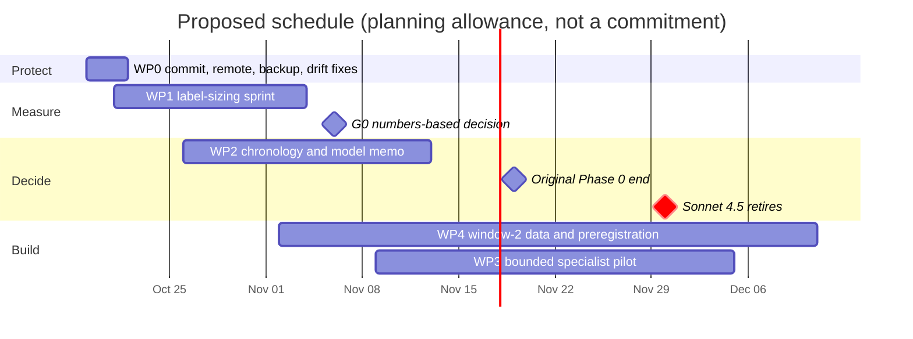

# Claude review and plan — October 17, 2026

> [!abstract] Verdict in four lines
> **Claims.** 42 ledger entries were tested by re-running or recomputing them, not by re-reading the notes. None was contradicted. Hashes, counts, test results and the fidelity of the data path reproduce exactly; the seven clinical and scientific statements I could check against public sources are correct. Three entries are stale or overstated in summary text (§3).
> **Direction.** The risk is not correctness. Nine days into a six-week Phase 0 the project has strong infrastructure and no label-set size, no power estimate, no live model and no preregistration, and the calendar moved under it: Claude Sonnet 4.5 retires on 2026-11-30, and every model in Anthropic's current lineup has a June 2026 training cutoff.
> **Fragility.** Everything since the last commit (Oct 16, 22:55 PDT; 58 paths) is uncommitted, there is no git remote, and the canonical release cannot be rebuilt from any existing commit.
> **Next.** Protect (commit, remote, backup) → measure (registry-scale label sizing with a tiered endpoint) → decide (model and origin chronology by 2026-11-13) → build (bounded specialist pilot, preregistration). §7 has the work packages and §8 the decisions only the PI can make.

Lineage of the project, for orientation: Oct 8 plan (H1–H6, Phase 0) → Oct 9 feasibility review (narrow to a feasibility phase) → Oct 10–11 framework v0.1→v0.2 and the first Claude audit → Oct 12 stabilization (git, CI, catalog owner, run registry) → Oct 13–15 AI-assisted T6 review → Oct 16 recipe 2.2, AACT 2023/2025, origin screen, IL6R pilot → Oct 17 long session (five snapshots, 2,206 inputs, bounded packets, full-cis) → program/outcome feasibility → Phase 3 linkage → advancement rules v0.3.

How to read this note. Evidence tags: **[V]** executed or recomputed in this review; **[R]** read from project files only; **[E]** fetched today from an external source; **[J]** judgment or arithmetic from verified inputs. Scripts and raw outputs for every [V] item are in `planning/review-assets/claude-review-20261017/`.

## 1. Bottom line

1. **The technical record is trustworthy.** Everything that can be recomputed matched: 728 sealed files, 2,206 raw inputs, six AACT archives, 2,205 Open Targets files against the publisher's own checksums, 29.8 million scanned evidence rows, 213 observations traced back to raw Parquet rows with 13,845 fields compared, an entire 2,979 × 2,979 LD matrix, ten dossier receipts, 173 tests. The sessions' hedging also held up everywhere I could test it.
2. **The project is infrastructure-complete and result-free.** [[Beyond the Virtual Biotech Tooling Gaps and Project Plan|The Oct 8 plan]] asked Phase 0 (six weeks, to about Nov 19) to size the label set, simulate power and file a preregistration. Day 10 of 42: zero qualified T1 events, no sized label universe, no live model adapter, no OSF filing. The offline T6 dossiers are verbatim evidence dumps (one claim per record), so they test copy fidelity, not the AsOf idea.
3. **"T1 no-go" is not yet evidence about T1.** The decision itself (do not train on 24 cases) is right, but it says little about T1:
   - The v0.3 primary endpoint (first dosing of the experimental regimen, with supported date bounds and verified historical content) is rarely observable from registry data alone: each event needs a dated sponsor or publication statement.
   - At any plausible 24-month transition rate (3% from my crude count below to 20% from the Oct 9 power assumption), even counting all 24 cases as at risk they are expected to contain 0.7–4.8 events (0.5–3.0 for the 15 non-excluded ones), so one lead is what any endpoint would have produced.
   - A crude pair-level count from the Virtual Biotech linkage, which lags registration (undercounting 2024) and links comparator arms, still finds **485–659 transitions** among 15.6k–46.8k at-risk target–indication pairs.
   - T1 therefore needs to be measured at scale before it is judged. That is the one line of the Oct 12 Gate E still open ("count eligible programs, events … from restored data"), and the endpoint I propose as primary (a registry-observable next-phase start) is the one the Oct 9 review recommended.
4. **The calendar changed.** Sonnet 4.5 (Virtual Biotech's default model) retires in 44 days. The Claude 5.5 family has June 2026 cutoffs, and no model in the lineup table in §7 has a training cutoff before July 2025, so the 2023→2025 window is development-only for all of them. Open Targets 25.09 (released 2025-09-17; its target, disease and non-ChEMBL evidence products are already collected in full) is contemporaneous with an October 2025 origin whose 12-month labels have already matured. That is a cheaper route to a leakage-controlled locked test than reconstructing history, but the model choice has to be made before Nov 30.
5. **Do the boring protective work first.** 58 uncommitted paths, no remote, evaluator bundles that exist only in gitignored folders, public anchors that are themselves untracked.
6. **Stop adding sealed bundles per micro-step.** After the long-session closeout (08:33 UTC) three more sealed bundles were produced by 15:26 UTC and none added a label. The proposed plan seals milestones, not steps.

## 2. Scope and method

- **Read in full:** README; the Oct 8 plan; the Oct 11 Claude review and project audit; the Oct 12 revised plan, stabilization report and feasibility gate decision; most of the Oct 9 feasibility analysis (its first 450 lines, through the recommended edits); every Oct 15–17 report (AI-assisted review, context revision, both AACT restorations, clinical/genetics pilot, long-session, full-cis, preflight, program/outcome, Phase 3, rules v0.3, updated plan); `MEMORY.md`, `project-goals` and the five Oct 17 logs; the run registry and the public manifests; the uncommitted diffs of `src/asof/{cli,ingest,maintenance}.py`; and the evaluator code that decides outcomes (`advancement_rules.py`, `apply_advancement_policy.py`, `program_outcomes.py`, `extract_phase3_followup.py`) with their tests.
- **Searched or skimmed only:** the Oct 9–16 research logs, `docs/FRAMEWORK.md`, `docs/V02_MIGRATION.md`, `data/DATA_PLAN.md`, the sealed bundles' contents (checked through manifests and targeted reads), and the remaining 3,000-odd lines of tools. **Not read:** the original critical review of agentic frameworks and the Oct 10 framework code review (superseded by later notes).
- **Executed:** the test suite; `tools/validate.py` in core and full mode (full mode used a portable PowerShell 7.6.7 zip from GitHub Releases, SHA-256 checked against GitHub's published digest, unpacked in the session scratchpad and never installed); the ten framework probes; registry-driven `asof verify` on all ten dossiers, also under code exported from `HEAD`; independent hash, count and trace passes listed in §3.
- **Fetched today:** ClinicalTrials.gov API, Merck and MacroGenics releases, Europe PMC, PMC, an NIH NCATS page quoting the ClinicalTrials.gov glossary, GitHub API and raw files for the pinned Virtual Biotech commit, Open Targets publisher checksum files, manifest, release notes and FTP headers, Ensembl REST, Anthropic model and deprecation pages.
- **Deliberately not done:** no PostgreSQL restart or re-import (the notes say never to; archive hashes and immutable-field checks stand in), no model-provider call ($0), nothing committed, nothing downloaded beyond public checksum files, headers, the portable PowerShell zip and the public pages above.
- **Limit worth stating up front:** checking local files against local anchors cannot detect a coordinated rewrite of both. Independence here comes from publisher checksums, live public records and recomputation from raw bytes, not from the project's own seals (§4 F6).

## 3. Verification ledger

Result vocabulary: **Confirmed**, **Confirmed (qualified)**, **Stale** (true once, no longer current), **Overstated** (summary text exceeds its own body), **Not verifiable here**.

### A. Code, tests and validation

| ID | Claim (where) | Check | Result |
| --- | --- | --- | --- |
| A1 | 149 tests, zero skips, ten probes and wheel pass at long-session closeout ([[Clinical Long Session Progress]]) | Read retained `framework-validation-*.json` (138–149 across five runs); re-ran today | **Confirmed**. The tree now has 173 tests (149 + 9 + 5 + 10). Core mode: 173 run, 1 expected skip (PowerShell 7 absent). Full mode with PowerShell 7.6.7: 173 run, 0 skips, `powershell_syntax` true, probes 10/10, wheel + dependency-free demo pass [V] |
| A2 | "36 / 26 / 21 relevant tests passed" (rules, Phase 3, program feasibility) | Counted test methods per module; read retained output | **Confirmed**: 10+9+5+5+3+4 = 36; 21 = 9+5+3+4; 26 = 21+5; retained run "Ran 36 tests … OK" [V] |
| A3 | Bounded packets keep every observation, stay within 64 MiB, default mode and oversized single observations still fail | Read the diff; property test: 300 random lists (ASCII and non-ASCII), exact-boundary cases, oversized observation, single layout | **Confirmed**, 0 violations [V] |
| A4 | Default backend offline, no provider calls, $0 default ([[README]]) | Searched `src/` for network or provider imports; read backend classes; compared CLI and `Budget` defaults | **Confirmed (static)**: none found; only `ExtractiveBackend` and `ReplayBackend`; 16 calls, 32,000 / 8,000 tokens, $0, 300 s, one retry [V] |
| A5 | No third-party runtime dependencies; ingestion pins pyarrow 21.0.0 | `pyproject.toml`; installed version | **Confirmed** [V] |
| A6 | Windows/Linux CI configured; hosted run unverified | Read workflow; `git remote -v` | **Confirmed** — and no remote exists, so it cannot have run [V] |
| A7 | Catalog holds 83 providers / 178 products | Counted; semantic diff of `sources.json` against `HEAD` | **Confirmed**. Only 3 datasets and the maintenance record differ; the 2,367-line `git diff` is re-serialization (1.57 → 1.22 MB) [V] |

### B. Integrity and provenance

| ID | Claim | Check | Result |
| --- | --- | --- | --- |
| B1 | Sealed evidence is byte-intact; manifest hashes quoted in notes | Re-hashed all 728 files in 9 manifests (7 cohort, 2 genetics); compared the quoted SHA-256s (d2413f77…, 5a676737…, 0fe05372…, 84cd52a1…, d9968672…) and byte totals; searched for unsealed files; walked the 3-parent chain (486 + 56 + 12) | **Confirmed**: 0 missing, size or hash errors; 0 unsealed files [V] |
| B2 | Public manifests anchor artifacts | 49 path + SHA-256 pairs in 35 public manifests | **Confirmed (qualified)**: 48 match. The one miss is the registry hash in `2026-10-16-context-revision.json`; it equals the version committed at 670778d, baf0ed1 and 0ca0b19, and the living registry has been updated since (uncommitted) [V] |
| B3 | Ten canonical dossiers verify | `asof verify --receipt-sha256` with the registry's hashes; report hashes for all 11 registry entries | **Confirmed**: `integrity_verified`, semantic consistency verified, `source_binding` current originals, `code_matches_current` true. Under code exported from `HEAD` the same runs verify but `code_matches_current` is false [V] |
| B4 | Five restored AACT archives (plus optional Jan 2026) match recorded hashes | Re-hashed six archives, 12.93 GB | **Confirmed**; the five restored sum to the catalog's 10,587,494,178 bytes [V] |
| B5 | 2,206 selected inputs, 9,038,960,079 bytes, all verified; 65 formerly missing now present | Re-hashed every file (SHA-256 and size) | **Confirmed** 2,206/2,206; 2,141 + 65 = 2,206 [V] |
| B6 | All 2,205 Open Targets files match publisher SHA-1 | Fetched the publisher's `release_data_integrity` (22,557 entries, equal to its own `.sha1`) and compared | **Confirmed** 2,205/2,205 (49 supplemental files matched by name) [V][E] |
| B7 | Open Targets 22.11 historical samples match publisher hashes | Four sample Parquets against the 22.11 SHA-256 list (35,534 entries) | **Confirmed** 4/4 (the three upstream files were not rechecked) [V][E] |
| B8 | Publisher manifest records a failed `coding_variant_view` step | Fetched 25.09 `manifest.json` | **Confirmed**; the release-level `result` is also "failure" (step failed 2025-09-03) [E] |
| B9 | Download worker and frozen manifest unchanged; monitor off; databases stopped | SHA-256 of `Start-DownloadBatch.ps1` and `v02-inputs.json`; process list; `postmaster.pid` in all five data directories | **Confirmed**: e432007f… and c78c5a92… as recorded; no downloader or Postgres process; no pid files [V] |

### C. Data, counts and fidelity

| ID | Claim | Check | Result |
| --- | --- | --- | --- |
| C1 | 29,823,171 rows scanned; 26,985 matched; 31,554 case records; 11 packets, largest 67,104,865 bytes | Independent scan of all 2,194 evidence files; per-case comparison; packet sizes on disk | **Confirmed**. Each case's observation count equals its raw matched rows; largest packet is 3,999 bytes under 64 MiB. Selection is exact (target, disease) only, no ontology descendants [V] |
| C2 | Normalization is faithful ("20-row audit") | Traced 213 random observations (up to 30 per hypothesis pair) to raw Parquet rows by row-group and row locator; compared 13,845 projected fields | **Confirmed**: 0 mismatches [V] |
| C3 | Dossiers: probability null, features empty, no live model | Read `prediction.json`, `features.json`, `run.json`, `ledger.json` for all ten | **Confirmed**: probability null, `audit_only`, `synthetic` false, 8/8 feature slots `not_measured`, backend `offline-extractive-v1`; claims equal observations in every case [V] |
| C4 | Virtual Biotech: 56,707 labels, 29,100 decisive endpoints, 488,361 linkage rows, 72,158 pairs, 1,520 targets, 2,559 diseases | Recomputed from the local files | **Confirmed**; closes the catalog blocker "not independently reproduced" [V] |
| C5 | About 1.61 TiB free on D:, 1.60 TiB on E: | `Get-PSDrive` | **Confirmed** [V] |
| C6 | Cross-note arithmetic | Recomputed | **Confirmed**: 16,914 + 14,640 = 31,554; 2,141 + 65 = 2,206; archive sizes sum; report windows 10/3/3/2 and content 8/6/4 recomputed from `reports.json` [V] |
| C7 | Restored Jan-2023 AACT contains genuine registry data | 24 selected origin records against live ClinicalTrials.gov | **Confirmed**: first-posted dates 24/24 equal; no posting after 2023-01-01; sponsor differences only at known transfers [V][E] |
| C8 | The Open Targets 25.09 inputs are the complete selected set ("zero missing"; "complete 2,194-file evidence selection, excluding ChEMBL") | Compared the 2,206-file manifest with the publisher's file list | **Confirmed**: all 2,194 non-ChEMBL evidence parts, all 10 target parts and the disease part are present; the only absent entries are two empty Spark `_SUCCESS` markers; the 100 ChEMBL parts are excluded by design [V][E] |
| C9 | Five-date timeline retains all 120 trial/snapshot observations, assigns no labels (README, [[Clinical Long Session Progress]]) | Counted `timeline.json` and `summary.json` | **Confirmed**: 24 trials × 5 dates = 120 observations, 0 missing, 0 clinical labels, 0 censoring dates; field differences 18 (status) and 2 (phase) [V] |

### D. Clinical, scientific and external-world claims

| ID | Claim | Check | Result |
| --- | --- | --- | --- |
| D1 | NCT06203210: Phase 3, ACTUAL start 2024-05-21, first posted 2024-01-12, I-DXd 12 mg/kg IV every 3 weeks vs physician's choice | Retained Jan-2025 extract against the live API | **Confirmed** (live last-update has since moved to 2026-08-06) [V][E] |
| D2 | First participant dosed by 2024-08-01 | Merck release | **Confirmed**: "August 1, 2024 8:00 am EDT … first patient has been dosed"; no date, no arm [E] |
| D3 | Actual start means first enrollment, not dosing | NIH NCATS page quoting the ClinicalTrials.gov glossary | **Confirmed**: "The actual date on which the first participant was enrolled in a clinical study." [E] |
| D4 | PMID 41051123 is an incompatible linkage (quarantined canary) | Europe PMC | **Confirmed**: Laryngoscope 2026;136:1150–7, retrospective review of 476 sinus-surgery cases, lists NCT03816891 (the vixarelimab prurigo-nodularis trial) [E] |
| D5 | N1303K sub-study (P12): primary nonsignificant, secondary improved | Europe PMC | **Confirmed**: n = 20; sweat chloride −1.1 mmol/L (95% CI −5.3 to 3.1, p = 0.61); ppFEV1 +9.5 points (p < 0.0001); Lancet Respir Med, 26 Aug 2024 [E] |
| D6 | Semaglutide vs dapagliflozin (P07): difference with nonsignificant subgroup interaction | PMC10822775 | **Confirmed**: Nat Metab, 4 Jan 2024; HbA1c −8.2 mmol/mol; interaction P = 0.7 [E] |
| D7 | TAMARACK (P19): dosing stopped, follow-up continued | MacroGenics release | **Confirmed**: July 30, 2024; IDMC advised stopping further dosing for remaining mCRPC participants; monitoring continues [E] |
| D8 | Sonnet 4.5 retires 2026-11-30; July 2025 training cutoff ([[AsOf Feasibility Analysis and Peer Survey]]) | Anthropic model and deprecation pages | **Confirmed** (deprecated 2026-09-30; replacement Sonnet 5.5). Haiku 4.5: reliable Feb 2025, training Jul 2025 [E] |
| D9 | Virtual Biotech pinned at 71f9da6 | GitHub API and raw files | **Confirmed**: 71f9da6 is still repository HEAD (2026-09-17), MIT, default model `claude-sonnet-4-5-20250929`, chief-of-staff and reviewer fixed to Haiku [E] |

### E. Genetics

| ID | Claim | Check | Result |
| --- | --- | --- | --- |
| E1 | Full-cis counts (6,120 / 5,325 / 5,722 / 50,412 / 2,979 / 503) | `revision-summary.json`; internal arithmetic; array shapes and file sizes | **Confirmed**: 6,120 − 5,325 = 795 duplicates; 5,722 rows with one conflicting key → 5,721; LD file bytes = 2,979² × 8 + 128 [V] |
| E2 | LD matrix independently recalculated (3,600 entries) | Recomputed all 8,874,441 entries from the stored dosages | **Confirmed**: max absolute difference 8.3e-15; symmetric; unit diagonal; rank 502, i.e. singular as stated [V] |
| E3 | GWAS metadata fails its published MD5 | MD5 of the retained file against the provider's list | **Confirmed**: e564a41a… against f0f6f56d… [V] |
| E4 | Window from Ensembl-105 `phenotype_pos` 154,405,193 | Ensembl REST today | **Confirmed (qualified)**: current IL6R start is 154,405,141 (52 bp annotation drift), immaterial to a ±1 Mb window [E] |

### F. Process and summary text

| ID | Claim | Check | Result |
| --- | --- | --- | --- |
| F1 | "Applied to all 24 development cases" ([[Program Advancement Rules v0.3]] summary line, `MEMORY.md`, `project-goals`) | Read `apply_advancement_policy.derive()` | **Overstated**: all 24 are accounted for, but the rules were evaluated on two hand-authored fact records (P01, P24); the body of the note says so [R] |
| F2 | Catalog describes current holdings | Compared records with disk and processes | **Stale**: `aact_snapshots` verification and blockers still say "no archive restored" with five archives restored; `chembl_molecules` is "partial" with a 3.0 GB `.partial` tarball idle since Oct 10; `ot_colocalisation_coloc` is "downloading" with no process [V] |
| F3 | Test count in the roadmap | Counted | **Stale**: "149 tests" in [[Updated Project Plan 2026-10-17]] and `project-goals`; now 173 [V] |
| F4 | "$0 provider spending; no live model" | Code and repository search | **Confirmed in code**; billing itself is not checkable here [V] |

### G. Not verifiable here

- AACT database internals (rows, constraints, indexes; the 2,078-match / 1,696-exclusion selection; 41 arm links; 32 candidate scopes): the databases were deliberately not restarted. Archive hashes and immutable-field agreement (C7) corroborate content, not these counts.
- The AI-assisted scientific judgments: 20 claims / 120 fields, eight origin-scope reviews, and 14 of the 18 source reports (I re-checked P01, P07, P12, P19 and the PMID canary).
- Peak-memory and wall-clock measurements; hosted CI; independence of any reviewer.

**Tally.** 42 entries: 35 confirmed, 4 confirmed with a stated qualification (A4 static only, B2, E4, F4 code only), 3 stale or overstated (F1–F3). Block G lists what I could not check. No claim was contradicted.

## 4. Findings

Severity is my judgment of consequence for the research goal, not of code quality.

### F1 — High: recent work is uncommitted, unpushed and partly unprotected
- [V] 58 uncommitted paths (16 modified, 42 untracked; counted before this review added its own files) after the last commit (0ca0b19, Oct 16 22:55 PDT); `git remote` is empty.
- [V] `data/benchmark/` and `data/derived/` are gitignored by design, so the sealed clinical bundles, the AI-review outputs and the active pointers exist on this machine only. The nine `data/manifests/public/2026-10-17-*.json` anchors that are meant to bind them are untracked.
- [V] A canonical dossier verifies under `HEAD` code with `code_matches_current: false`; `HEAD`'s CLI has no `--packet-layout`. The complete-input release cannot be rebuilt from any existing commit.
- [V] A pattern scan of the 211 non-ignored files (keys, tokens, signed URLs, private keys, password assignments) found 0 hits, so a private push is not blocked on secrets; the scan is pattern-based only.
- Why it matters: one disk fault or careless `git clean` removes the day's work, and the integrity story has no durable anchor. Builds on [[Full Repository Review and Verified Findings_claude10112026|the Oct 11 finding]] that there was no version control; git now exists but is not being used as the record.
- Fix: WP0.

### F2 — High: the T1 "no-go" is a statement about a definition and a sample, not about T1
- [R] `advancement_rules.evaluate()` returns *qualified* only when about a dozen conditions hold at once: four scope relations, explicit `origin_active` and `origin_at_risk`, an allowed phase edge, experimental-arm first dosing, an in-window interval, `bounds_quality == supported`, a report by the endpoint, `historical_content == verified`, a reviewed event link. ClinicalTrials.gov records first enrollment, not dosing [E]; the v0.3 note itself says the choice "can reduce event observability".
- [R] The rules ran on two hand-authored fact records. The other 22 cases are "accounted for" by the absence of a retained lead, which is not a next-phase search.
- [J] Base rates: if an at-risk program's 24-month next-phase probability is anywhere in 3–20%, 24 cases give 0.7–4.8 expected events (0.5–3.0 for the 15 cases not excluded at origin). One lead (P01, shared with P24) is what any endpoint would produce, so the pilot cannot tell "observable" from "unobservable".
- [V] Crude sizing from the Virtual Biotech linkage (`scripts/crude_pair_sizing.py`; contemporary mapping, lags registration, comparators included, so a rough bound only): at origin 2023-01-01, **46,819** target–indication pairs have a Phase ≤ 2 trial and **659** show a higher-phase start within 24 months (394 from Phase 1, 265 from Phase 2; 303 targets, 190 diseases). Restricting to pairs with Phase 1/2 activity in the preceding five years: **15,631** pairs, **485** transitions (3.1%), **343** within 12 months.
- Comparative framing. [[AsOf Feasibility Analysis and Peer Survey|The Oct 9 review]] recommended "documented Phase 2-to-Phase 3 progression within a fixed horizon among programs active at the origin" and said "starting a higher-phase trial is a development event". v0.3 narrows that further, to arm- and dose-level first dosing. The arm-level caution is justified by real problems (see F4), but it belongs in an audit tier, not in the primary endpoint.
- The prevalence that matters is still unmeasured. The Oct 9 power table (504–1,762 independent cases for a 0.05 AUROC gap) assumes 20% progression prevalence, i.e. roughly 100–350 positives. My pair-level 1.4–3.1% includes dormant pairs and a lagging linkage; the figure that decides feasibility is the transition rate among programs actually **active** at origin, which only a registry-scale count can give. At 3% prevalence the same case numbers would need an enriched (all positives plus sampled negatives) design.
- Fix: tiered endpoint and a sizing sprint (WP1). Do not spend the next session qualifying origin arms for the 15 remaining cases: at best that yields 0–3 events and cannot change the decision. Use those cases as the pilot for the audit protocol instead.

### F3 — High: model and origin chronology no longer match the plan
- [E] Sonnet 4.5 (`claude-sonnet-4-5-20250929`): deprecated 2026-09-30, **retires 2026-11-30**, training cutoff Jul 2025. Haiku 4.5: training Jul 2025, retirement "not sooner than 2026-10-15" with at least 60 days' notice. Opus 4.6: training Aug 2025, not before 2027-02-05. Sonnet 4.6: training Jan 2026. Fable 5.1, Opus 5.5, Sonnet 5.5 and Haiku 5.5: reliable knowledge and training cutoff Jun 2026.
- [E] Virtual Biotech at the pinned commit defaults to Sonnet 4.5, fixes Haiku for the chief-of-staff and reviewer, and accepts `--model claude-opus-4-6`.
- [E] Open Targets 25.09 was released 2025-09-17 (release notes). All 2,205 selected files carry a publisher `Last-Modified` of 2025-08-19 (08:52–21:02 UTC; one transient HEAD failure was retried), and the integrity list and manifest are dated 2025-09-17. The next release, 25.12, is dated 2025-12-10. A timestamp is an upper bound on first-public time, not proof of it, but it is better provenance than the 2026-10-11 download receipts the catalog uses today.
- [J] Consequences: (i) the 2023→2025 window is development-only for every model in the §7 table; (ii) a leakage-controlled LLM test needs an origin after the model's training cutoff, which for Opus 4.6 or the 4.5 models means September–October 2025 or later; (iii) OT 25.09 is the latest release at an October 2025 origin, so the evidence side of a locked test needs no historical reconstruction, only an origin-dated AACT snapshot; (iv) the Oct 9 conclusion that outcomes cannot mature before Aug 2027 holds for 24-month horizons only. The table in §7 lays out model, cutoff and clean-origin options.
- Credit and constraint. The Oct 9 review (§5.3) already floated a 12-month task for an August 2025 origin and warned it "must be justified and preregistered, not selected after comparing performance"; the Oct 12 plan repeats that. The chronology above is the justification, and nothing in this review looked at window-2 outcomes: the only data I touched for that window is the contemporaneous linkage, which holds one transition after 2025-08. Preregister before anyone looks (D6).

### F4 — Medium–High: the only ready-made trial→target map stops in mid-2024 and links comparators
- [V] Distinct trial start dates in the linkage by year: about 3.3–3.7k per year for 2016–2022, 2,723 (2023), 1,829 (2024), 54 (2025), 6 (2026); highest NCT number NCT06486441.
- [V] NCT06203210 is mapped to topotecan (TOP1) and amrubicin (TOP2A), the active comparators, and not to I-DXd or CD276.
- Why it matters: labels built from it undercount 2024 transitions and credit comparator targets with advancement. The sessions' instinct to work at arm level is vindicated here; the remedy is experimental-arm restriction in AACT, not abandoning scale.

### F5 — Medium: the T6 "dossiers" are evidence dumps and scale linearly to a hard limit
- [V] One claim per observation in all ten ledgers. CFTR: 12,549 claims, `dossier.md` 44.0 MiB, `ledger.json` 128.2 MiB, 50.1% of the 256 MiB ledger bound; GLP1R 99.6 MiB, 38.9%. About 10.5 KiB of ledger per observation puts the ceiling near **25,000 observations per case** [J]. The [[README]] calls `dossier.md` "the readable report".
- Why it matters: the ten outputs verify a copy operation (supported by construction); they cannot test H5 or any extraction quality. Well-studied target–disease pairs could exceed the ceiling [J].
- Fix: before adding cases, add bounded selection with coverage accounting. A deterministic top-k-by-provider-score baseline is the fair non-LLM comparator for any model-backed specialist (WP3).

### F6 — Medium: verification is largely self-referential
- [R] Sealed manifests and "public anchors" are local byte-integrity seals written by the same pipeline (their own text says so). The replay verifiers re-run the generating code, which proves reproducibility, not correctness. The anchors are not in git history. AI-assisted reviews are unblinded and share a model family.
- [V] My independent passes (publisher checksums, live registry, raw-byte recomputation) found no drift, so the practical risk today is low. The structural risk is that nothing off-machine or human-adjudicated yet backs a headline claim.
- Fix: commit the anchors, push, and pre-specify human adjudication of a random sample before any published claim (WP3, WP4).

### F7 — Medium: provenance ceremony is outrunning results
- [V] 8 sealed cohort directories, 35 public manifests, 21 planning notes and 17 memory notes beside 3,350 lines of runtime code and 3,964 lines of tools (about 570 KB of Markdown across notes, docs and READMEs). After the long-session closeout at 08:33 UTC, the program/outcome build (three attempts, 14:27–14:35 UTC), the Phase 3 linkage (sealed 14:54) and the rules bundle (sealed 15:26) each added a sealed directory, a public manifest, a planning note, a research log and an index entry.
- Each step ends with a new "next bounded work" item, and none of them tests H1–H6. The rigor is not the problem; proportion is. Seal milestones, not steps, and keep one dated lab-notebook entry per session in `memory/`.

### F8 — Low–Medium: catalog and summary-text drift
- See ledger F1–F3. Also [V]: `git diff` of `sources.json` is 2,367 changed lines for 41 semantic edits because the writer re-serializes; stable formatting would keep diffs reviewable.

### F9 — Low: housekeeping
- The LICENSE appendix placeholder flagged on Oct 11 (finding 15) was mis-framed: `Copyright [yyyy] [name of copyright owner]` is part of the standard Apache-2.0 text. The open item is a rights-holder notice (README or NOTICE) [R].
- PowerShell 7 is not installed on this machine, so `tools/validate.py --mode full` fails its precondition here; core mode skips one test.
- Source IDs embed the literal path spelling of the manifest (noted in [[Context Revision Completion]]), so a Linux build from a Windows-authored manifest would change source identities. Hosted CI runs on fixtures and will not reveal this; add an identity-migration rule before any non-Windows real-data build.
- Sealed bundles contain 43 third-party page bodies (1.8 MB) and registry extracts; keep them out of any public benchmark release.

### What the sessions did well (calibration)
Failures are retained rather than hidden (the registry lists at least three failed or incomplete attempts), "no silent truncation" is enforced and property-tested, the ten required probes pass, scientific hedging matches the external record in every case I could check, and the code has no path that could spend provider money. These are the reasons the integrity checks came back clean.

## 5. Follow-through on the October 11 Claude review

| # | Finding ([[Full Repository Review and Verified Findings_claude10112026]]) | Status today |
| --- | --- | --- |
| 1 | No version control | Closed for history (11 commits since Oct 12); **open** for Oct 17 and the remote (F1) |
| 2 | No live model backend | Open by design |
| 3 | No real prediction on real data | Open by design (T6 only) |
| 4 | No CI | Configured; never executed (no remote) |
| 5 | Feasibility blockers unresolved | Partly closed: AACT restored; model retirement now dated (F3); UKB-PPP replaced by an eQTL Catalogue pilot; power and 24-month horizon still open |
| 6 | T6 + Program contract gap | Closed (checks apply to T6; tests in `test_stabilization.py`; probe F01 passes) |
| 7 | Hard-coded output name in `Sync-DownloadCatalog.ps1` | Closed (timestamped default, refuses overwrite, `#Requires -Version 7.0`) |
| 8 | `Watch-DownloadBatch.ps1` batch-id mismatch | Closed (identity read from the queue) |
| 9 | Exact-string `.Replace()` over prose | Closed (report-only script; single catalog owner `asof.maintenance`) |
| 10 | `prepare_v02_inputs.py` hard-coded paths | Closed (`--raw-root`, `--queue`) |
| 11 | `build_demo_v2.py` hidden dependency | Closed (argparse, explicit check for preserved inputs) |
| 12 | Probe gate treats `None` as pass | Closed (`required_probes_passed` needs `passed is True` for every probe) |
| 13 | Two writers of `sources.json` | Closed (single owner) |
| 14 | Superseded runs undiscoverable | Closed (run registry with states) |
| 15 | LICENSE copyright line | Reframed; rights-holder notice still open (F9) |
| 16 | Conditional test silently no-ops | Closed (conditional removed; portable legacy fixture and probe) |

Tally: 10 closed (6–14, 16), 3 partly open (1, 4, 5), 2 open by design (2, 3), 1 reframed (15). Items 1 and 4 both reduce to the missing remote (F1); item 5 is the subject of F2 and F3.

## 6. Position against the October 8 plan

| Plan element | Status on Oct 17 | Evidence |
| --- | --- | --- |
| Phase 0: size the label set, simulate power, file preregistration (to about Nov 19) | Not done; day 10 of 42 | 24 purposive cases, 0 qualified events; power exists only as the Oct 9 closed form (504–1,762 independent cases for a 0.05 AUROC gap, depending on paired correlation) |
| G0: enough decisive pairs; label audit kappa ≥ 0.8 | Unmeasured | no double-annotated labels; AI-assisted, unblinded review only |
| G1: Virtual Biotech runs unchanged on masked data; canaries stay hidden | Not started | commit 71f9da6 pinned; no AACT-at-T0 shim or egress control for the Virtual Biotech arm; a future-canary test exists only for AsOf's own fixtures (`test_framework.py`) |
| G2: scorer beats genetics-only on rolling origins | Not started | T1 scorer path exercised only on fictional fixtures |
| H1–H6 | All untested | H5 has technical source fidelity only (F5) |
| T1 / T6 | T1 interface only / T6 offline harness | no labels / ten dossiers |
| Spend | $0 | no provider code path exists |
| June 2027 preprint | At risk for any 24-month claim | see F3; a methods-and-benchmark paper is the Oct 9 fallback and is still reachable |

Net learning from the pilots, worth keeping: registry status is not outcome (UNKNOWN, reporting lag, stale states); comparator, rescue, background and closed-arm anchors contaminate naive mappings (4 of 24 excluded for anchor role, plus the Virtual Biotech comparator links); events are rare enough that any LLM evaluation needs an enriched sample; very large evidence sets break linear designs; the data path is sound. Oct 12 Gate E remains the project's own decision rule; WP1 below executes its unfinished line.

## 7. Proposed plan

**Principles.** (1) Measure before engineering. (2) One endpoint hierarchy, amended in writing, never silently. (3) Chronology table before any model run. (4) AI-assisted work is development; anything published gets independent human adjudication of a random sample. (5) Seal milestones, commit every session. (6) $0 stays the default; each live step has a stated cap and no automatic retries of uncertain billed calls (already the design, per the README).

### Model and origin options [E][J]

| Model | Training-data cutoff | Retirement (Claude API) | Earliest clean origin | 12-month labels mature |
| --- | --- | --- | --- | --- |
| Sonnet 4.5, Haiku 4.5 | Jul 2025 | Sonnet: 2026-11-30; Haiku: not sooner than 2026-10-15 | Aug 2025 | Aug 2026 (now) |
| Opus 4.6 | Aug 2025 | not sooner than 2027-02-05 | Sep 2025 | Sep 2026 (now) |
| Sonnet 4.6 | Jan 2026 | not sooner than 2027-02-17 | Feb 2026 | Feb 2027 |
| Fable 5.1, Opus 5.5, Sonnet 5.5, Haiku 5.5 | Jun 2026 | not sooner than Sep–Oct 2027 | Jul 2026 | Jul 2027 |

"Earliest clean origin" is the month after the training cutoff; "mature" means origin plus 12 months, before reporting lag.

Candidate locked-test window **O1**: origin 2025-10-01, evidence = Open Targets 25.09, 12-month horizon, models with cutoff ≤ Aug 2025. Window 2023→2025 remains the development and non-LLM scorer window. **O2** (origin ≥ Jul 2026, Claude 5.5 models) is a later prospective extension.

### Work packages

**WP0 — Protect (Oct 19–21, about 1 day).**
- Commit in logical groups (runtime and tests; catalog and public manifests; evaluator tools and tests; planning and memory notes; this review and its assets), create a private remote, push, and watch the first hosted run on Windows and Linux.
- Back up `data/benchmark/` (0.07 GiB), `data/derived/` (0.6 GiB) and the E: evidence manifests off-machine; test-restore one bundle. Keep the sealed bundles out of any public repository: they hold third-party page bodies.
- Repair catalog and note drift (ledger F1–F3): refresh `aact_snapshots` verification, mark idle downloads as stalled, keep serialization stable, correct "applied to all 24" and the test counts.
- Acceptance: clean `git status`; CI result recorded; restore test passed.

**WP1 — Phase 0 label-sizing sprint (Oct 21–Nov 4, about 8–10 working days).**
1. *Amendment v0.4, written before counting.* Tier A (primary, registry-observable): first interventional trial of the next numerical phase for the same alias-resolved drug in the same condition family with a registry start date of type ACTUAL after origin and by endpoint. Tier B (audit gold): the v0.3 strict rule. Tier C (descriptive): trial initiation, efficacy, safety, administrative events, as in v0.3. Unit: drug–indication program, rolled up to target–indication (the Oct 8 head-to-head question is pair-level) with "any program" and "one program per hypothesis" sensitivity. Eligibility: interventional Phase 1/2, active status at origin, EXPERIMENTAL arms only.
2. *Build* at-risk programs from the 2023-01-01 snapshot and transitions from the four later restored snapshots (SQL over `studies`, `interventions`, `design_groups`, `design_group_interventions`, `conditions`, `sponsors`), mapping names to targets through the already collected Open Targets 25.09 molecule and mechanism tables (evaluator side only). For window 1 that mapping postdates the origin, so label it an oracle mapping, quarantine it as the Oct 9 note (§2.3) advises, and use it for sizing only; for window 2 the same tables are origin-eligible.
3. *Report* at-risk and event counts by phase edge, base rates, drug, target and sponsor clusters, snapshot-interval bracketing error.
4. *Audit sample:* about 120 candidate transitions plus 120 matched non-transitions, two annotators (one independent human), kappa, Tier A precision and recall against Tier B, minutes per case. Reuse P01 and the 15 non-excluded cases as the protocol pilot.
5. *Power simulation* with cluster resampling at the measured prevalence and dependence; dossier-cost table.
- Output: one short decision note and one sealed bundle. **Go/no-go rule (freeze before counting):** simulated power at least 0.8 for a 0.05 AUROC gap at an affordable N, or fall back to the methods-and-benchmark paper.

**WP2 — Chronology and model memo (Oct 26–Nov 13; decision Nov 13).**
Choose O1 or a later origin, the model(s) for AsOf and Virtual Biotech, and the run budget. Include contamination probes and canaries, and the network containment the Oct 9 note (§1.5) requires for the Virtual Biotech arm (its specialists have Bash and web tools). Retirement dates matter: runs that depend on Sonnet 4.5 must finish before Nov 30; Haiku 4.5 is hard-wired in the Virtual Biotech reviewer and can retire with 60 days' notice.

**WP3 — Bounded T6 specialist pilot (Nov 9–Dec 4, about 10–12 working days with review).**
- Implement one model-backed `Backend` behind the existing quote/select contract with bounded retrieval (never the 60–80 MiB case evidence), coverage accounting and a hard `--max-cost-usd`. At default budgets a run is capped at 32,000 input and 8,000 output tokens, about $0.36 at Opus 4.6 list prices ($5 / $25 per MTok) [J], so a pilot of a few hundred runs is a low-hundreds-of-dollars decision.
- Add the deterministic top-k baseline; evaluate on the ten development hypotheses plus ten fresh ones frozen before looking; claim-level rubric (source fidelity, relevance to action and modality, context fit, completeness, unsupported synthesis); two independent human reviewers on at least 40 claims; paired comparison to extractive and top-k baselines with cost and latency.
- Stop rule: if the specialist does not beat the top-k baseline on the rubric, do not scale; revisit the design.

**WP4 — Window-2 data and preregistration (Nov 2–Dec 11, parallel).**
Obtain an AACT snapshot near 2025-10-01 and the latest available one (the PI must confirm they are offered in the AACT account; I could not check); finish ChEMBL or rely on Open Targets mechanisms for drug→target; HGNC as of that quarter. Preregister on OSF: hypothesis meanings (H1–H6 unchanged), endpoint tiers, windows, models, analysis plan and stopping rules, frozen before window-2 labels are inspected.

**WP5 — Genetics (hold).** Keep the IL6R pipeline as a technical pilot. Resume only when WP1 shows T1 is viable, and then restrict to the targets that will actually be in the benchmark; defer DICE and OneK1K replication.

**WP6 — Documentation economy (continuous).** One dated notebook entry per session; milestone-level sealing; no HTML review pages unless a human reviewer needs one; no new copies of repository code inside sealed bundles.



Findings map to packages as follows: F1 → WP0; F2, F4 → WP1; F3 → WP2 and WP4; F5 → WP3; F6 → WP0, WP3, WP4; F7 → WP6; F8, F9 → WP0.

### Done means (by about Dec 11)
Everything committed to a remote with a recorded CI run; a numbers-based G0 note; an accepted chronology memo; a drafted preregistration; pilot results with cost; and a one-page statement of what the June 2027 paper will and will not claim (base case: methods and benchmark with T6 audit and a 12-month T1 window, H1 and H2 reported with intervals whichever way they fall; I would not plan around a headline "better than Virtual Biotech" result unless WP1 shows an affordable sample near the 504–1,762-case range of the Oct 9 analysis).

### Risks

| Risk | Likelihood | Response |
| --- | --- | --- |
| Window-2 events too few (the crude count gives about 340 pair-level transitions over 12 months in the 2023 window; window 2 itself is unmeasured, and mapping and filtering will cut the number) | Medium–High | Pool Phase 1→2 and 2→3; 18-month horizon; matched pairs (T2); report as pilot with intervals |
| AACT snapshot near Oct 2025 or the latest is not offered | Medium | Use the Jan 2026 archive already held for the endpoint; derive origin state from Jan 2025 plus registry dates; label the limitation |
| Virtual Biotech run cost (the plan's $46–54 per dossier [R]) | High | Run it on a subsample first; decide the cap after WP1 |
| Haiku 4.5 or Opus 4.6 retire earlier than expected | Low–Medium | Fork Virtual Biotech with a pinned model map; finish the comparison within the notice window |
| First hosted run fails on Linux-specific assumptions (paths, line endings, PowerShell) | Medium | Treat as WP0 work; the real-data identity rule (F9) is separate |
| Scope exceeds staffing (flagged Oct 9) | High | Methods-and-benchmark base case; H4, H6 and T2–T5 deferred |

## 8. Decisions needed from the PI

| # | Decision | My recommendation |
| --- | --- | --- |
| D1 | Commit the working tree, create a private remote, set up an off-machine backup | Yes, this week |
| D2 | Endpoint policy | Tiered: Tier A registry-observable primary, v0.3 as the audit tier |
| D3 | Locked-test window and models | O1 (origin 2025-10-01, 12-month horizon, Opus 4.6; Sonnet 4.5 only if runs finish before Nov 30); 2023→2025 stays development and non-LLM |
| D4 | First live-model spend | Authorize a capped pilot (low hundreds of dollars) for WP3; set the Virtual Biotech cap after WP1 |
| D5 | Human reviewers | Two domain reviewers for at least 40 claims in WP3 and the WP1 audit sample; schedule now |
| D6 | Preregistration timing | Freeze after WP1 and WP2, before inspecting window-2 labels |
| D7 | Data acquisition | Confirm AACT snapshot availability near 2025-10-01 and latest (the Oct 9 review saw indexed monthly lists for 2017–2026 but nothing is confirmed in your account); finish or replace the idle 3.0 GB ChEMBL download |

## 9. Limits of this review

- Local files were checked against local seals as well as external sources; the external and recomputed checks carry the independence (§2).
- External pages were read through a summarizing fetch tool; wherever a number matters I cross-checked a second source or the retained record.
- I read the evaluator code that decides outcomes and the runtime diffs closely, but not all 3,964 lines of tools.
- Scientific interpretation of the 20 reviewed claims, the origin-scope reviews and most source reports was not re-adjudicated.
- Crude sizing is an order-of-magnitude aid, not a label set (F2, F4).
- Checks on this note itself: every count, size and tally it quotes from the repository or from saved results is recomputed by `scripts/selfcheck_review_numbers.py` (43 assertions, all passing when the note was finalized). Not machine-checked: [E] quotations from external pages, and [J] items (base-rate arithmetic, the model-window logic, effort and cost estimates).

## Appendix A — Reproduction

From `D:\Projects\drug_target_agents` (PowerShell):

```powershell
uv run --no-sync python -m unittest discover -s tests                 # 173 tests
uv run --no-sync python tools/validate.py --mode core --package       # PowerShell 7 absent: 1 expected skip
# Full mode needs PowerShell 7 on PATH (portable zip from GitHub Releases, SHA-256 checked); then:
uv run --no-sync python tools/validate.py --mode full --package
```

Review scripts live in `planning/review-assets/claude-review-20261017/scripts/`; each prints JSON that is saved next to it in `results/`. See the README in that folder for the list, run times and interpreter notes.

## Appendix B — External sources used

ClinicalTrials.gov API (NCT06203210); Merck release of 2024-08-01; NIH NCATS FAQ (par-24-272); Europe PMC records for PMID 41051123 and 39208836; PMC10822775; MacroGenics release of 2024-07-30; GitHub API and raw files for harrisongzhang/TheVirtualBiotech at 71f9da6; Open Targets 25.09 `release_data_integrity`, `.sha1`, `manifest.json`, FTP headers and release notes; Open Targets 22.11 `release_data_integrity.sha256`; Ensembl REST for ENSG00000160712; Anthropic models overview, deprecations page and the Sonnet 4.5, Haiku 4.5, Sonnet 4.6 and Opus 4.6 model pages.
